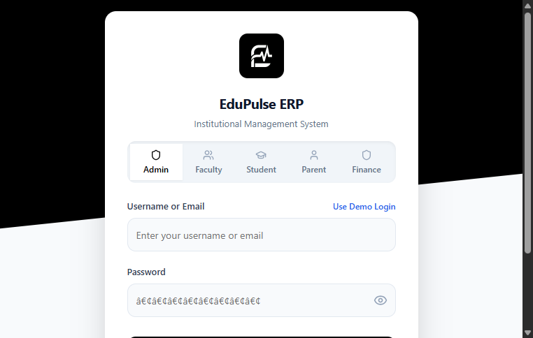
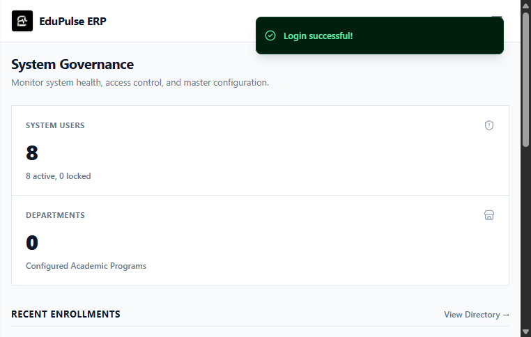
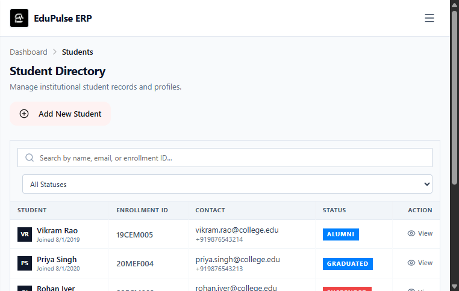
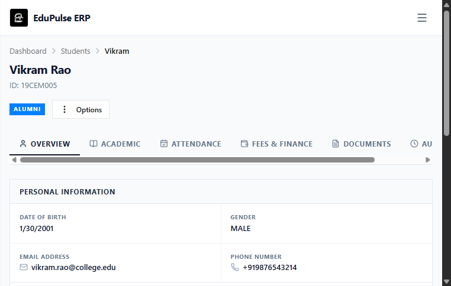
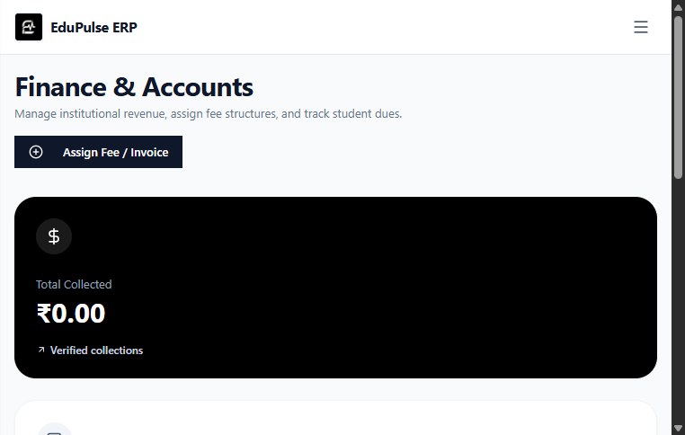
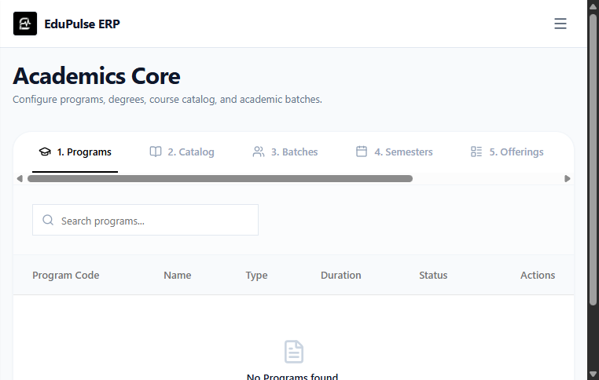
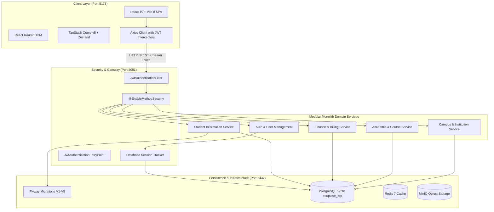
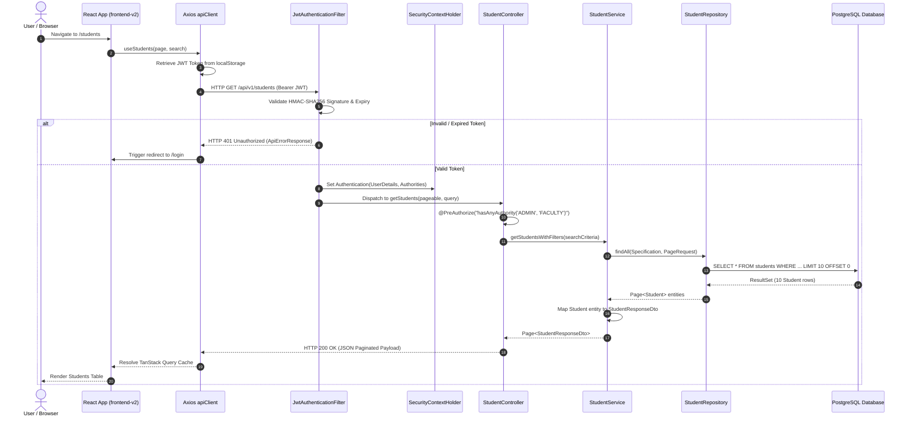

# EduPulse

> **Canonical Enterprise Resource Planning Documentation for Higher Education Institutions**  
> *Architected with Java 21 LTS, Spring Boot 3.3.4, PostgreSQL 17/18, Flyway Migrations, React 19, and Vite 8.*

[](backend/pom.xml)
[](backend/pom.xml)
[](frontend-v2/package.json)
[](frontend-v2/package.json)
[](edupulse/docker-compose.yml)
[](backend/src/main/resources/db/migration/)
[](.github/workflows/ci.yml)
[](#21-license-acknowledgements--owner-action-register)

---

## Abstract

Modern higher education institutions struggle with operational silos, fragmented student records, uncoordinated fee tracking, and insecure credential management. **EduPulse** addresses these challenges by delivering a centralized, multi-tenant capable, modular monolith built on **Spring Boot 3.3.4 (Java 21 LTS)** and a modern **React 19** frontend.

The platform provides a comprehensive **Student Information System (SIS)** supporting multi-attribute search, guardian linking, multipart document archiving, and an immutable academic status transition state machine (Active, Inactive, Suspended, Graduated, Alumni). Security is enforced through stateless JWT authentication backed by database-tracked session revocation, method-level Role-Based Access Control (`@PreAuthorize`), and strict Insecure Direct Object Reference (IDOR) mitigations. Database integrity is preserved across 5 Flyway migrations (`V1` to `V5`), enforcing relational cascades, payment idempotency keys, and automated identity linking.

Quality assurance is verified through a dual-profile test architecture comprising an in-memory **H2** developer test suite, an isolated **PostgreSQL 17** integration suite (`edupulse_test`) protected by fail-fast test safety guards (`PostgresSafetyGuard`), a 35-test SIS acceptance matrix, and live browser workflow acceptance across 18 administrative and academic routes. The system is containerized via Docker Compose, including production-ready multi-stage build definitions.

*Read the full academic abstract and problem definition in [`docs/project-overview/abstract.md`](docs/project-overview/abstract.md).*

---

## Er. RAM BABU BURI - Project Mentor

**Er. Ram Babu Buri** serves as the **Project Mentor and Technical Advisor** for EduPulse ERP. As an academician and engineering educator, he provided foundational project guidance, technical direction, and architectural oversight throughout the design and realization of this enterprise institutional management system.

| Attribute | Profile & Academic Details |
| :--- | :--- |
| **Portrait** |  |
| **Mentor Name** | **Er. Ram Babu Buri** |
| **Academic Designation** | Assistant Professor, Department of Computer Science & Engineering (CSE) |
| **Institutional Affiliation** | Arya College of Engineering & I.T. (ACEIT), Jaipur, Rajasthan, India |
| **Educational Qualification** | Master of Technology (M.Tech.) in Computer Science & Engineering |
| **Stated Research Domain** | Machine Learning & Data Science *(Team-provided)* |
| **Core Technical Stack** | Java, JSP & Servlets, Spring Boot, MySQL, Python *(Team-provided)* |
| **Professional Profiles** | [](https://www.linkedin.com/in/er-ram-babu-buri-85654b67/) [](https://www.researchgate.net/profile/Ram-Babu-Buri) |

### Areas of Technical Expertise

Technical guidance and advisement for the project encompass enterprise backend frameworks, relational persistence, and data-driven systems:

[](https://www.oracle.com/java/)
[](https://jakarta.ee/)
[](https://spring.io/projects/spring-boot)
[](https://www.mysql.com/)
[](https://www.python.org/)
[](https://scikit-learn.org/)

- **Enterprise Java & Frameworks**: Java, JSP–Servlet web architectures, Spring Boot modular backend engineering, and clean API design.
- **Data Persistence & Relational Design**: Schema normalization, transaction management, and persistence patterns using MySQL.
- **Python & Data Engineering**: Scientific computing, data analysis pipelines, and machine learning implementations in Python.
- **Research Stated Focus**: Machine Learning and Data Science applied to intelligent automation, predictive modeling, and institutional systems.

### Verified Academic & Research Profile

- **Designation & Institutional Role**: Assistant Professor in the Department of Computer Science & Engineering at **Arya College of Engineering & I.T. (ACEIT)**, Jaipur, Rajasthan, India.
- **Academic Qualifications**: Holds a Master of Technology (**M.Tech.**) in Computer Science & Engineering.
- **Selected Scholarly Contributions & Publications**:
  - Co-author, *"A Review on Different Machine Learning Algorithms to Breast Cancer Risk Prediction"*, published in the **IIP Series** ([Publisher Link](https://www.iipseries.org/)).
  - Co-author, *"Early-Stage Breast Cancer Diagnosis: A Deep Learning-Based Image Processing Approach"*, published in **IET Conference Proceedings** ([IET Digital Library](https://digital-library.theiet.org/)).
  - Scholarly works and publications spanning automated institutional setups, kiosk-based reception workflows, and predictive analytics.

### Mentorship Acknowledgment

> *"The EduPulse project team extends its sincere appreciation to **Er. Ram Babu Buri** for his valuable technical mentorship, architectural guidance, and academic direction. His feedback on enterprise software standards, robust design patterns, and engineering discipline has been instrumental in shaping the EduPulse ERP platform."*

### Connect & Profiles

- **LinkedIn**: [https://www.linkedin.com/in/er-ram-babu-buri-85654b67/](https://www.linkedin.com/in/er-ram-babu-buri-85654b67/)
- **ResearchGate**: [https://www.researchgate.net/profile/Ram-Babu-Buri](https://www.researchgate.net/profile/Ram-Babu-Buri)
- **YouTube**: [https://youtube.com/@techvidyapeeth2024?si=O3jOLTN6ekgg4TDG]
- **Instagram**: [https://www.instagram.com/errambabuburi?srtk=MWM1NTFhdzJ5enVweA==]
---

### Core Team Members & Project Contributors

| Member Name | Project Role | Git Author / Profile | Key Responsibilities & Contributions |
| :--- | :--- | :--- | :--- |
| **Lakshya Goyal** | Project Lead & Full-Stack / System Integration Lead | [`2204Zero`](https://github.com/2204Zero)<br/>`lakshyagoyal701@gmail.com` | Overall EduPulse system integration; end-to-end coordination across backend, frontend, database, and deployment; system-wide audits and bug tracking; frontend hardening and integration fixes; cross-module regression testing; release preparation, deployment configuration, project documentation, and final acceptance/demo coordination. |
| **Palak Agarwal** | Student Information System (SIS) Lead | `inagarwalpalak2005@gmail.com`<br/>*(Profile link pending)* | End-to-end design and implementation of the Student Information System (SIS); Student Profile CRUD, pagination, and multi-field search (`com.erp.student`); Guardian management and 1:N relational linking (`com.erp.guardian`); Student document repository (`StudentDocument`); Student status lifecycle state machine with immutable audit logging (`StudentStatusHistoryService`); 35 automated test cases in the master SIS test suite (100% pass rate); Automated demo harness `StudentModuleDemonstrationTest.java` and companion scripts (`run_student_demo.ps1`, `run_student_demo.bat`). |
| **Manish Sharma** | Security & Access Control Lead | `sharmamanish48118@gmail.com`<br/>*(Profile link pending)* | Enterprise authentication, JWT bearer token lifecycle, and database-backed session management (`Session` entity, `SessionService`); Dynamic user-role assignment with JPA `@ElementCollection` and role normalization (`RoleAssignmentService`); Method-level security enforcement (`@EnableMethodSecurity`) and custom JSON error handling (`JwtAuthenticationEntryPoint`, `CustomAccessDeniedHandler`); Secure password recovery workflow with 15-minute single-use UUID tokens (`PasswordResetToken`); Security integration test suites (`AuthenticationIntegrationTest`, `RbacAndPermissionIntegrationTest`). |
| **Lakshya Singhal** | Frontend Architect & Lead Hardening | [`lakshyasinghal08`](https://github.com/lakshyasinghal08)<br/>`lakshyasinghal92@gmail.com` | Enterprise frontend architecture across `src/` and `frontend-v2/` (React 19, Vite 8, TanStack Query v5, Zustand, Tailwind CSS); Centralized typed HTTP client (`apiClient`), Axios interceptors, correlation IDs, and token refresh queues (`DATA_LAYER_README.md`, `INTEGRATION_README.md`); Generic in-memory cache manager with TTL invalidation; Responsive administrative dashboard with KPI metrics and role-based route guards (`RoleGuard`); PostgreSQL integration test harness, concurrency hardening (`FinanceConcurrencyPostgresIT`), and fail-fast test security guards (`PostgresSafetyGuard`). |
| **Prashant Jain** | Institutional & Campus Lead | `prashantjain.code@gmail.com`<br/>*(Profile link pending)* | Institution metadata, accreditation records, and multi-campus relational hierarchy (`CampusController`, `InstitutionController`); Campus registration, facility details, and directory endpoints; Academic scheduling security evaluators and timetable constraint validation (`AcademicSchedulingSecurity.java`); Co-authored Git branch registry conventions (`docs/Branch-Registry.md`). |

### 12-Week Team Progress Reports, Research Paper & SRS

- 📄 **Complete Team Progress Reports (Weeks 01–12)**: [Google Drive Folder — Comprehensive Team Weekly Reports](https://drive.google.com/drive/folders/1qEcbbcQ26jBKeXZZCySOKK-qaf-Bnw73?usp=sharing)
- 📑 **Project Research Paper**: [Google Docs — EduPulse Academic Research Paper](https://drive.google.com/file/d/1AAW-zOuC4NHQQw2-xJAAAUX4mWrgBaH9/view?usp=sharing)
- 📋 **Software Requirements Specification (SRS)**: [Google Docs — EduPulse Software Requirements Specification (SRS)](https://docs.google.com/document/d/1DItdPC9wVLq4hNJcIpa7_gOUHRfnTDBj/edit?usp=sharing&ouid=107702636253744643600&rtpof=true&sd=true)

## 📑 Table of Contents

1. [Project Introduction & Identity](#1-project-introduction--identity)
   - [Project Mentor](#er-ram-babu-buri---project-mentor)
   - [Core Team Members & Project Contributors](#core-team-members--project-contributors)
   - [12-Week Team Progress Reports, Research Paper & SRS](#12-week-team-progress-reports-research-paper--srs)
   - [Application Screenshots](#application-screenshots)
   - [Quick Start Guide](#quick-start-guide)
   - [Release Verification Summary](#release-verification-summary)
   - [Repository Directory Structure](#repository-directory-structure)
2. [Overview](#2-overview)
3. [Problem Statement & Objectives](#3-problem-statement--objectives)
4. [Scope, Boundaries & User Roles](#4-scope-boundaries--user-roles)
5. [Features & Module-Status Acceptance Matrix](#5-features--module-status-acceptance-matrix)
6. [Technology Stack](#6-technology-stack)
7. [System Architecture & UML Diagrams](#7-system-architecture--uml-diagrams)
8. [Database Design & Persistence](#8-database-design--persistence)
9. [Security Architecture & Access Control](#9-security-architecture--access-control)
10. [Team Members, Roles & Contributions](#10-team-members-roles--contributions)
11. [Weekly Progress Reports & Sprint Logs](#11-weekly-progress-reports--sprint-logs)
12. [Project Documents & Deliverables Index](#12-project-documents--deliverables-index)
13. [Demonstration Materials & Walkthroughs](#13-demonstration-materials--walkthroughs)
14. [Testing Documentation, QA & CI/CD Evidence](#14-testing-documentation-qa--cicd-evidence)
15. [Installation & Local Development Guide](#15-installation--local-development-guide)
16. [API Documentation & Conventions](#16-api-documentation--conventions)
17. [Deployment & Container Architecture](#17-deployment--container-architecture)
18. [Roadmap, Known Limitations & Future Work](#18-roadmap-known-limitations--future-work)
19. [Practical Troubleshooting Guide](#19-practical-troubleshooting-guide)
20. [Contributing & Governance](#20-contributing--governance)
21. [License, Acknowledgements & Owner-Action Register](#21-license-acknowledgements--owner-action-register)

---

## 1. Project Introduction & Identity

**EduPulse** is an enterprise-grade academic and administrative management platform engineered to unify university operations into a cohesive, secure, and performant modular monolith. Designed for universities, colleges, and polytechnic institutes, the system integrates student records, guardian directories, document archiving, academic lifecycle transitions, role-based access control, fee billing, and campus infrastructure.

- **Primary Repository**: [`Institutioanl_ERP_v1.0`](https://github.com/2204Zero/Institutioanl_ERP_v1.0.git)
- **Authoritative Frontend**: [`frontend-v2/`](frontend-v2) (React 19 / Vite 8 SPA running on port 5173)
- **Secondary Frontend**: [`frontend/`](frontend) / [`src/`](src) (React 18 / Vite 5 initial sprint client)
- **Authoritative Backend**: [`backend/`](backend) (Spring Boot 3.3.4 REST service running on port 8081)
- **Primary Database**: PostgreSQL 17 / 18 Alpine (Docker Compose configured with Flyway migrations `V1`–`V5`)
- **Active Release Baseline**: `v1.0-RC1` (Branch: `develop`, Commit: `dcd9524`)

### Application Screenshots

| Authentication & Role Switcher | System Governance & Dashboard |
| :---: | :---: |
| <br/>*Unified login with multi-role preview selector* | <br/>*Administrative governance dashboard & metrics* |
| **Student Information Directory** | **Student Profile & Academic Detail** |
| <br/>*Searchable SIS directory with lifecycle status tags* | <br/>*Individual student profile with multi-tab record views* |
| **Finance & Fee Management** | **Academics Core & Course Catalog** |
| <br/>*Institutional fee collection and account balances* | <br/>*Academic programs, course offerings, and semesters* |

### Quick Start Guide

The fastest path to run EduPulse locally requires zero external database installation using the in-memory developer profile:

#### 1. Zero-Dependency Developer Run (Fastest Path — H2 Profile)
- **Prerequisites**: JDK 21 LTS (Temurin/OpenJDK) & Node.js 22 LTS (npm 10+)
- **Terminal 1 (Backend REST Service)**:
  ```powershell
  cd backend
  .\mvnw.cmd spring-boot:run
  ```
  *Starts Spring Boot on port 8081 using in-memory H2 with pre-seeded demo accounts and Swagger UI enabled.*
- **Terminal 2 (Authoritative Frontend SPA)**:
  ```powershell
  cd frontend-v2
  npm install
  npm run dev
  ```
  *Starts the React 19 application on http://localhost:5173 with automated proxy forwarding to port 8081.*

#### 2. Full Containerized Stack Run (PostgreSQL 18 + Infrastructure)
- **Step 1 — Start Services**:
  ```powershell
  cd edupulse
  docker compose up -d
  ```
  *Starts PostgreSQL 18 (port 5432), Redis 7 (port 6379), RabbitMQ 3 (port 5672/15672), and MinIO (port 9000).*
- **Step 2 — Launch Backend with Production Profile**:
  ```powershell
  cd ..\backend
  .\mvnw.cmd spring-boot:run -Dspring-boot.run.profiles=prod -Dspring-boot.run.arguments="--DB_PASSWORD=edupulse_secure_password_2026 --JWT_SECRET=404E635266556A586E3272357538782F413F4428472B4B6250645367566B5970"
  ```
  *Automatically applies Flyway migrations `V1` through `V5` against PostgreSQL.*
- **Step 3 — Launch Frontend**:
  ```powershell
  cd ..\frontend-v2
  npm run dev
  ```

#### 3. Verified Local Access Endpoints
- **Web Application UI**: [`http://localhost:5173`](http://localhost:5173)
- **Backend REST API**: `http://localhost:8081/api/v1`
- **Interactive Swagger UI**: [`http://localhost:8081/swagger-ui.html`](http://localhost:8081/swagger-ui.html)
- **OpenAPI v3 Specification**: `http://localhost:8081/v3/api-docs`
- **H2 Console (Dev Profile)**: `http://localhost:8081/h2-console` (`jdbc:h2:mem:erp_db`, User: `sa`, Password: *empty*)
- **Default Superadmin Credentials**: `superadmin` / `Admin@123` (or click "Use Demo Login" on `/login`)

*For advanced configuration, production deployment, and environment variables, see [Section 15: Installation Guide](#15-installation--local-development-guide).*

### Release Verification Summary

The table below summarizes verified release evidence for baseline `v1.0-RC1`:

| Verification Area | Verified Result | Evidence Source | Last Verified |
| :--- | :--- | :--- | :---: |
| **Release Baseline** | `v1.0-RC1` (Branch: `develop`, Commit: `dcd9524`) | Git working tree & commit logs | 2026-10-12 |
| **Backend Unit & Security Suites (H2)** | **49 Passed / 0 Failed / 0 Errors** | `mvn clean test` (`backend/src/test/java/com/erp/`) | 2026-10-12 |
| **SIS Master Acceptance Suite** | **35 / 35 Passed (100% Pass Rate)** | [`docs/test-cases/ALL_MODULES_COMPLETE_TEST_SUITE.txt`](docs/test-cases/ALL_MODULES_COMPLETE_TEST_SUITE.txt) | 2026-10-12 |
| **PostgreSQL 17 Integration Tests** | **10 IT Suites Passed** (`FlywayMigrationPostgresIT`, `FinanceConcurrencyPostgresIT`, etc.) | `mvn verify -P postgres-it` against `edupulse_test` | 2026-10-12 |
| **Integration Test Safety Guard** | Active (`PostgresSafetyGuard` aborts on `edupulse_erp` / `one`) | `backend/src/test/java/com/erp/it/postgres/PostgresSafetyGuard.java` | 2026-10-12 |
| **Authoritative Frontend Build (`frontend-v2`)** | **Clean Build** (TypeScript 5 `tsc -b` & Vite 8 bundle, 0 errors) | `npm run build` in `frontend-v2/` | 2026-10-12 |
| **Secondary Frontend Build (`frontend`)** | **Clean Build** (TypeScript 5 `tsc` & Vite 5 bundle, 0 errors) | `npm run build` in `frontend/` | 2026-10-12 |
| **Browser Workflow Acceptance** | **18 / 18 Routes & Flows Accepted** | [`docs/testing/master-test-report.md#5-live-browser-end-to-end-acceptance-ledger`](docs/testing/master-test-report.md#5-live-browser-end-to-end-acceptance-ledger) | 2026-10-12 |
| **Continuous Integration Pipeline** | GitHub Actions 3-job matrix (`frontend`, `backend`, `backend-postgres-it`) | [`.github/workflows/ci.yml`](.github/workflows/ci.yml) | 2026-10-12 |
| **Known Limitations & Deferred Scope** | Attendance, Documents, and Audit tabs on Student Detail show explicit pending notices | `frontend-v2/src/pages/StudentDetail.tsx` (see [Section 18.4](#184-documented-limitations)) | 2026-10-12 |

*Full test breakdown and execution logs available in [`docs/testing/master-test-report.md`](docs/testing/master-test-report.md).*

### Repository Directory Structure

The following tree represents the verified, meaningful organization of the repository across backend services, frontend applications, deployment infrastructure, migrations, tests, and documentation:

```text
Institutional_ERP_v1.0/
├── README.md                                  # Canonical project entry point & master architecture guide
├── CONTRIBUTING.md                            # Contribution guidelines, branching rules & PR standards
├── SECURITY.md                                # Vulnerability disclosure policy & security controls
├── CHANGELOG.md                               # Version history & release candidate audit logs
├── DATA_LAYER_README.md                       # Frontend data layer, caching & HTTP client architecture
├── INTEGRATION_README.md                      # Frontend–backend integration flow & JWT queue guide
├── package.json                               # Root package manifest (React 18 / legacy frontend tooling)
├── tsconfig.json                              # TypeScript configuration for root client source
├── vite.config.ts                             # Vite configuration for root client
├── tailwind.config.js                         # Tailwind CSS configuration for root client
├── .dockerignore                              # Root Docker build exclusion rules
├── .gitignore                                 # Git version control exclusions
├── run_student_demo.ps1                       # Automated PowerShell one-click SIS demo runner
├── run_student_demo.bat                       # Automated Windows Batch one-click SIS demo runner
│
├── backend/                                   # Spring Boot 3.3.4 (Java 21 LTS) backend service
│   ├── pom.xml                                # Maven build descriptor and dependency definitions
│   ├── mvnw / mvnw.cmd                        # Maven wrapper executables
│   ├── .dockerignore                          # Backend Docker build exclusion rules
│   ├── java security/                         # Sprint security documentation
│   │   └── Day_1_to_6_Documentation.md        # Session, auth, user, role & recovery sprint notes
│   └── src/
│       ├── main/
│       │   ├── java/com/erp/                  # Core domain packages (modular monolith)
│       │   │   ├── academic/                  # Programs, courses, academic calendar, offerings
│       │   │   ├── admin/                     # System administrative management
│       │   │   ├── admission/                 # Student admissions workflow
│       │   │   ├── attendance/                # Class session & student attendance tracking
│       │   │   ├── auth/                      # Authentication, sessions, user management
│       │   │   ├── campus/                    # Campus facilities & directory controllers
│       │   │   ├── common/                    # Shared DTOs, utilities, exceptions
│       │   │   ├── config/                    # Spring configuration & OpenAPI 3 definitions
│       │   │   ├── dashboard/                 # KPI metrics aggregation endpoints
│       │   │   ├── department/                # Academic departments management
│       │   │   ├── faculty/                   # Faculty profiles & workload allocations
│       │   │   ├── finance/                   # Fee structures, billing, payment processing
│       │   │   ├── guardian/                  # Student guardian directory & relationships
│       │   │   ├── institution/               # Institution profile & governance
│       │   │   ├── security/                  # JWT filters, entry points, access handlers
│       │   │   └── student/                   # Student entity, profile CRUD, docs, status history
│       │   └── resources/
│       │       ├── application.yml            # Core Spring runtime configuration (port 8081, dev active)
│       │       ├── application-dev.yml        # In-memory H2 dev profile & demo superadmin seed
│       │       ├── application-prod.yml       # Production profile (PostgreSQL datasource, Flyway enabled)
│       │       ├── application-test.yml       # Integration test profile configuration
│       │       └── db/migration/              # Flyway database migrations
│       │           ├── V1__baseline_erp_schema.sql
│       │           ├── V2__persistent_user_management.sql
│       │           ├── V3__enforce_faculty_fk.sql
│       │           ├── V4__link_users_to_domain_entities.sql
│       │           └── V5__payment_idempotency.sql
│       └── test/java/com/erp/                 # Automated test suites
│           ├── AuthenticationIntegrationTest.java
│           ├── RbacAndPermissionIntegrationTest.java
│           ├── campus/ / institution/         # Controller & MockMvc unit tests
│           ├── guardian/ / student/           # SIS unit tests & demo harness
│           └── it/postgres/                   # PostgreSQL 17 integration tests & PostgresSafetyGuard
│
├── frontend-v2/                               # Authoritative modern React 19 frontend application
│   ├── package.json                           # Dependencies: React 19, Vite 8, TanStack Query v5, Zustand
│   ├── vite.config.ts                         # Vite configuration (port 5173, proxy rules)
│   ├── tsconfig.json                          # TypeScript configuration
│   ├── tailwind.config.js                     # Tailwind CSS design system tokens
│   ├── README.md                              # Vite/React template documentation
│   └── src/
│       ├── components/                        # UI components (dialogs, tables, navigation, layouts)
│       ├── config/                            # API endpoints & environment constants
│       ├── hooks/                             # Custom React hooks (queries, mutations, auth)
│       ├── pages/                             # Route views (Dashboard, Campuses, Students, Finance)
│       ├── store/                             # Client-side state stores (Zustand)
│       └── types/                             # TypeScript type definitions and interfaces
│
├── src/                                       # Secondary / initial sprint frontend source
│   ├── components/ / config/ / hooks/         # Modular React 18 component structure
│   ├── pages/ / services/ / store/ / types/   # Integration services, Axios client, token storage
│   └── utils/                                 # Cache manager, pagination & filter utilities
│
├── edupulse/                                  # Infrastructure, database containerization & DBA scripts
│   ├── docker-compose.yml                     # Local compose (Postgres 18, Redis 7, RabbitMQ 3, MinIO)
│   ├── docker-compose.prod.yml                # Production multi-stage container deployment
│   ├── .env.example                           # Safe environment variable configuration template
│   ├── README.md                              # Database operations, HikariCP & backup documentation
│   └── V1_create_core_database.sql ...        # 3NF database design scripts (V1 through V26)
│
├── database/                                  # Relational schema reference DDL and seed scripts
│   ├── schema/                                # Day-wise table definitions (students, guardians, docs, status)
│   └── seeds/                                 # Initial development seed records
│
├── docs/                                      # Comprehensive project documentation repository
│   ├── Branch-Registry.md                     # Official Git branch naming rules & contributor registry
│   ├── screenshots/                           # Verified UI screenshots for documentation
│   ├── project-overview/
│   │   └── abstract.md                        # Academic abstract, problem statement & criteria
│   ├── architecture/
│   │   └── system-architecture.md             # 4-Tier architecture, sequence & component diagrams
│   ├── database/
│   │   └── schema-design.md                   # Relational schema design & foreign key rules
│   ├── reports/
│   │   └── weekly-progress-reports.md         # Team contributor registry & sprint logs (Days 01–06)
│   ├── testing/
│   │   └── master-test-report.md              # Unified QA report, test matrix & browser audit ledger
│   ├── test-cases/                            # Automated test specifications
│   │   ├── ALL_MODULES_COMPLETE_TEST_SUITE.txt# 35-Test SIS acceptance & traceability matrix
│   │   └── day01_... to day06_...             # Day-by-day test case definitions
│   └── API/
│       └── student-api-spec.md                # REST API specifications, DTOs & curl commands
│
└── .github/
    └── workflows/
        └── ci.yml                             # GitHub Actions CI matrix (Frontend, Backend H2, Postgres IT)
```

---

## 2. Overview

Modern higher education institutions struggle with operational silos, fragmented student records, uncoordinated fee tracking, and insecure credential management. **EduPulse** addresses these challenges by delivering a centralized, multi-tenant capable, modular monolith built on **Spring Boot 3.3.4 (Java 21 LTS)** and a modern **React 19** frontend.

The platform provides a comprehensive **Student Information System (SIS)** supporting multi-attribute search, guardian linking, multipart document archiving, and an immutable academic status transition state machine (Active, Inactive, Suspended, Graduated, Alumni). Security is enforced through stateless JWT authentication backed by database-tracked session revocation, method-level Role-Based Access Control (`@PreAuthorize`), and strict Insecure Direct Object Reference (IDOR) mitigations. Database integrity is preserved across 5 Flyway migrations (`V1` to `V5`), enforcing relational cascades, payment idempotency keys, and automated identity linking.

Quality assurance is verified through a dual-profile test architecture comprising an in-memory **H2** developer test suite, an isolated **PostgreSQL 17** integration suite (`edupulse_test`) protected by fail-fast test safety guards (`PostgresSafetyGuard`), a 35-test SIS acceptance matrix, and live browser workflow acceptance across 18 administrative and academic routes. The system is containerized via Docker Compose, including production-ready multi-stage build definitions.

*Read the full academic abstract and problem definition in [`docs/project-overview/abstract.md`](docs/project-overview/abstract.md).*

---

## 3. Problem Statement & Objectives

### 3.1 Problem Statement
Higher education administrative operations suffer from four core operational failures:
1. **Identity & Record Inconsistency**: Lack of an immutable separation between database identity (`Student.id`) and institutional enrollment identity (`rollNumber`), causing data drift.
2. **Access Control Gaps**: Insecure Direct Object Reference (IDOR) vulnerabilities enabling cross-student document or grade inspection.
3. **Data Integrity Hazards**: Unversioned schema modifications leading to database drift across deployment environments.
4. **Concurrency Vulnerabilities**: Duplicate billing entries and timetable room double-booking during peak operational windows.

### 3.2 Primary & Secondary Objectives
- **Primary**: Deliver a unified, multi-campus Student Information System (SIS) managing profiles, guardians, documents, and lifecycle state changes.
- **Secondary**: Implement robust method-level security (`@PreAuthorize`), version-controlled database migrations (Flyway `V1`–`V5`), and sub-second paginated API querying.

### 3.3 Measurable Acceptance Criteria
1. **100% Test Pass Rate** on the 35 automated SIS test cases ([`docs/test-cases/ALL_MODULES_COMPLETE_TEST_SUITE.txt`](docs/test-cases/ALL_MODULES_COMPLETE_TEST_SUITE.txt)).
2. **Zero Failures** on Spring Boot test suites (`AuthenticationIntegrationTest`, `RbacAndPermissionIntegrationTest`, `StudentControllerTest`).
3. **Deterministic Fail-Safe Integration Testing**: `PostgresSafetyGuard` must immediately abort execution if pointed at non-test databases (`edupulse_erp`, `one`).
4. **Clean Dual Frontend Compilation**: Both `frontend-v2/` and root `frontend/` compile cleanly with 0 TypeScript compilation errors.

---

## 4. Scope, Boundaries & User Roles

### 4.1 System Boundaries & Scope

| Functional Area | Scope Status | Implementation Evidence | Operational Notes |
| :--- | :---: | :--- | :--- |
| **Student Profile CRUD** | **Complete** | `com/erp/student/`, `frontend-v2/src/pages/StudentsList.tsx` | Search, filtering, pagination verified |
| **Guardian Management** | **Complete** | `com/erp/guardian/`, `StudentDetail.tsx` (Guardians Tab) | Primary/secondary contacts linked to student |
| **Student Lifecycle Status** | **Complete** | `StudentStatusHistoryService.java`, `StudentStatus.java` | Status state machine with audit history |
| **Security & Authentication** | **Complete** | `JwtAuthenticationFilter.java`, `SessionService.java` | JWT rotation, DB session revocation |
| **Campuses & Institutions** | **Complete** | `CampusController.java`, `CampusesList.tsx` | Multi-campus directory and detail views |
| **Flyway Migrations (V1–V5)** | **Complete** | `backend/src/main/resources/db/migration/` | Baseline, users, FKs, identity links, idempotency |
| **Academic Programs & Courses** | **Verified (API/UI)** | `academic/` controllers, `AcademicPrograms.tsx` | Degree programs and courses directory |
| **Finance & Fee Structures** | **Verified (API/UI)** | `finance/` controllers, `FeeStructures.tsx` | Fee categories and payment transactions |
| **Student Detail Sub-Tabs (Attendance, Docs, Audit)** | **Explicitly Deferred** | `StudentDetail.tsx` | Student sub-views display explicit pending notices (see [Section 18.4](#184-documented-limitations)) |

### 4.2 Stakeholders & User Roles

| Role Name | Authority String | Permitted Workflows & Permissions | Operational Restrictions |
| :--- | :--- | :--- | :--- |
| **Super Admin** | `ROLE_SUPER_ADMIN` | Institutional governance, campus creation, database maintenance, user provisioning, global auditing | Cannot modify immutable audit trails directly |
| **Academic Admin** | `ROLE_ADMIN` | Student admissions, program catalog management, timetable generation, fee structure definitions | Restricted from system security token revocation |
| **Faculty Member** | `ROLE_FACULTY` | Attendance marking, syllabus tracking, course offerings, grade submission for assigned sections | Restricted to assigned department and course sections |
| **Student** | `ROLE_STUDENT` | Viewing personal profile, academic timetable, enrolled courses, and fee statements | Strict IDOR guards prevent access to other student records |
| **Guardian** | `ROLE_GUARDIAN` | Monitoring linked student attendance, academic notices, and pending fee obligations | Read-only access restricted to linked student IDs |

---

## 5. Features & Module-Status Acceptance Matrix

Status classifications strictly adhere to audited repository evidence:
- **Complete**: Implemented, backed by unit/integration tests, and accepted via live browser audits.
- **Partially Complete**: Backend APIs and domain entities complete; frontend integration active in specific views or deferred in nested tabs.
- **Planned / Deferred**: Documented in architectural roadmap but intentionally decoupled from current release candidate.

| Module | Backend API | Frontend UI | Authorization | Automated Tests | Browser Verified | Overall Status |
| :--- | :---: | :---: | :---: | :---: | :---: | :---: |
| **Authentication & Login** | Done | Done | Enforced | Done | Done | **Complete** |
| **Student Information (SIS)** | Done | Done | Enforced | Done | Done | **Complete** |
| **Guardian Directory** | Done | Done | Enforced | Done | Done | **Complete** |
| **Student Status History** | Done | Done | Enforced | Done | Done | **Complete** |
| **Campuses & Institutions** | Done | Done | Enforced | Done | Done | **Complete** |
| **Academic Programs** | Done | Done | Enforced | Done | Done | **Complete** |
| **Courses & Offerings** | Done | Done | Enforced | Done | Done | **Complete** |
| **Fee Structures & Billing** | Done | Done | Enforced | Done | Done | **Complete** |
| **Flyway Database Migrations**| Done | N/A | N/A | Done | N/A | **Complete** |
| **Document Storage (Inline)** | Done | Partial | Enforced | Done | API Verified | **Partially Complete** |
| **Attendance Tracking** | Done | Partial | Enforced | Done | API Verified | **Partially Complete** |
| **Audit Trail Log Viewer** | Done | Partial | Enforced | Done | API Verified | **Partially Complete** |

---

## 6. Technology Stack

| Layer | Technology | Verified Version | Purpose & Location in Repository |
| :--- | :--- | :--- | :--- |
| **Runtime Language** | Java (OpenJDK / Temurin) | `21 LTS` | Core backend programming language ([`backend/pom.xml`](backend/pom.xml)) |
| **Backend Framework** | Spring Boot | `3.3.4` | Application framework, dependency injection, and REST controllers |
| **Security Framework** | Spring Security | `6.3.3` | Filter chains, JWT bearer authentication, and method security |
| **ORM / Persistence** | Hibernate / Spring Data JPA | `6.5.3.Final` | Relational entity mappings and repository query abstraction |
| **Database Engine** | PostgreSQL | `17.x` / `18-alpine` | Primary ACID relational database ([`edupulse/docker-compose.yml`](edupulse/docker-compose.yml)) |
| **In-Memory Database** | H2 Database | `2.2.224` | Rapid zero-dependency developer unit & controller testing |
| **Database Migrations** | Flyway Community | `10.17.3` | Version-controlled DDL migrations `V1` to `V5` |
| **Frontend Framework** | React | `19.2.8` | Authoritative SPA framework ([`frontend-v2/package.json`](frontend-v2/package.json)) |
| **Frontend Build Tool** | Vite | `8.3.0` | High-speed development server and production bundler |
| **Data Fetching / Cache** | TanStack Query | `v5.62.8` | Asynchronous server-state management, cache deduplication |
| **State Management** | Zustand | `v5.0.2` | Minimalist client-side authentication and session state |
| **UI Components** | Radix UI + Lucide React | Modern | Accessible primitives and high-clarity iconography |
| **CSS Architecture** | Tailwind CSS | `v3.4.17` | Utility-first styling framework |
| **Message Broker** | RabbitMQ | `3-management-alpine` | Asynchronous event processing and background notifications |
| **Distributed Cache** | Redis | `7-alpine` | Token blacklisting, session state, and query caching |
| **Object Storage** | MinIO | `RELEASE.2024` | S3-compatible document storage (PDFs, transcripts, IDs) |
| **Testing Harness** | JUnit 5 + MockMvc + AssertJ | `5.10.3` | Backend unit, integration, and security testing suites |
| **Continuous Integration**| GitHub Actions | `v4` | Automated CI matrix validating frontend and backend builds |

---

## 7. System Architecture & UML Diagrams

### 7.1 High-Level Modular Monolith Architecture
The platform adopts a 4-Tier Modular Monolith design that guarantees ACID transactions and data consistency across operational modules:



### 7.2 End-to-End Request Lifecycle Sequence
The sequence below illustrates a representative authenticated request flow (`GET /api/v1/students`):



### 7.3 Visual Architecture Resources & Links
- **Comprehensive System Architecture Specification**: [`docs/architecture/system-architecture.md`](docs/architecture/system-architecture.md)
- **Frontend Data Management Layer Architecture**: [`DATA_LAYER_README.md`](DATA_LAYER_README.md)
- **Frontend–Backend Integration Sequence & JWT Queue**: [`INTEGRATION_README.md`](INTEGRATION_README.md)
- **Relational Entity Relationship Diagram & Schema**: [`docs/database/schema-design.md`](docs/database/schema-design.md)

---

## 8. Database Design & Persistence

### 8.1 Flyway Versioned Migrations Ledger
All schema modifications are strictly managed via Flyway versioned migrations located in [`backend/src/main/resources/db/migration/`](backend/src/main/resources/db/migration/):

1. **`V1__baseline_erp_schema.sql`** (21 KB): Establishes baseline tables (`users`, `campuses`, `departments`, `programs`, `courses`, `faculty`, `students`, `guardians`, `student_documents`, `timetables`, `attendance`, `fee_structures`, `payments`).
2. **`V2__persistent_user_management.sql`**: Introduces persistence fields and security indexes to user governance.
3. **`V3__enforce_faculty_fk.sql`**: Enforces relational integrity linking faculty members to academic departments.
4. **`V4__link_users_to_domain_entities.sql`**: Introduces `user_id` foreign keys and unique constraints across `students` and `faculty`, cleanly decoupling login credentials from domain records.
5. **`V5__payment_idempotency.sql`**: Enforces unique constraint `uq_payments_idempotency_key` preventing double-billing on concurrent payment attempts.

### 8.2 Student Identity Model: `Student.id` vs `rollNumber`
- **`Student.id` (BIGSERIAL / Primary Key)**: Internal database surrogate key used exclusively for foreign key relationships, join efficiency, and physical indexing.
- **`rollNumber` (VARCHAR / Unique Key)**: Backend-generated, immutable institutional identifier (e.g., `STU-001`) assigned upon official enrollment. Decoupling ensures that physical database maintenance or sharding never breaks institutional identity.

*Detailed database schema documentation available in [`docs/database/schema-design.md`](docs/database/schema-design.md) and [`edupulse/README.md`](edupulse/README.md).*

---

## 9. Security Architecture & Access Control

- **Stateless JWT with Database Tracking**: Authenticated sessions receive HMAC-SHA256 signed JWTs. Tokens are tracked in the database `sessions` table (`Session` entity) to enable administrative revocation and logout verification.
- **BCrypt Password Encryption**: Passwords are encrypted via `BCryptPasswordEncoder` before database persistence.
- **Single-Use Password Recovery**: 15-minute single-use UUID tokens marked with a `used` boolean flag thwart replay attacks (`PasswordResetToken`).
- **Method-Level Security**: Controllers enforce granular access via `@PreAuthorize("hasAuthority('...')")`.
- **Insecure Direct Object Reference (IDOR) Mitigation**: Endpoints serving student-specific documents or profiles verify that the caller identity matches requested resource ownership.
- **Fail-Fast Test Safety Guard (`PostgresSafetyGuard`)**: Enforces environment isolation by aborting integration tests that target operational databases (see [Testing](#14-testing-documentation-qa--cicd-evidence)).

*Full security policy available in [SECURITY.md](SECURITY.md) and [`backend/java security/Day_1_to_6_Documentation.md`](<backend/java security/Day_1_to_6_Documentation.md>).*

---

## 10. Team Members, Roles & Contributions

For contributor profiles, Git author identities, and end-to-end responsibilities, see the opening [Core Team Members & Project Contributors](#core-team-members--project-contributors) table.

The matrix below maps each member's module ownership to verified deliverables and repository evidence:

| Member Name | Primary Owned Modules | Major Verified Deliverables | Repository Evidence Sources |
| :--- | :--- | :--- | :--- |
| **Lakshya Goyal** | System Integration, Release Hardening, Documentation | Overall EduPulse integration, release candidate hardening, documentation system | Git history, release audit reports |
| **Palak Agarwal** | Student Profile, Guardians, Documents, Status History | SIS Controller & Services, 35-test master suite, `run_student_demo.ps1` | [`docs/test-cases/`](docs/test-cases/), `backend/src/main/java/com/erp/student/` |
| **Manish Sharma** | Authentication, Sessions, User Roles, Password Recovery | `SessionService`, `AuthenticationIntegrationTest`, RBAC method security | [`backend/java security/Day_1_to_6_Documentation.md`](<backend/java security/Day_1_to_6_Documentation.md>) |
| **Lakshya Singhal** | Data Management Layer, Dashboard, Integration Architecture | `frontend-v2/`, `DATA_LAYER_README.md`, `INTEGRATION_README.md`, Postgres IT safety | [`DATA_LAYER_README.md`](DATA_LAYER_README.md), [`INTEGRATION_README.md`](INTEGRATION_README.md), [`frontend-v2/`](frontend-v2) |
| **Prashant Jain** | Campuses, Departments, Academic Security Constraints | `CampusController`, `InstitutionController`, `AcademicSchedulingSecurity.java` | `backend/src/main/java/com/erp/campus/`, `institution/` |

*Official Git branch allocations and conventions are recorded in [`docs/Branch-Registry.md`](docs/Branch-Registry.md).*

---

## 11. Weekly Progress Reports & Sprint Logs

Development progressed through structured sprint days documented in [`docs/reports/weekly-progress-reports.md`](docs/reports/weekly-progress-reports.md):

| Sprint Phase | Module Focus | Member Lead | Key Deliverables & Achievements |
| :--- | :--- | :--- | :--- |
| **Day 01** | Database Schema & Foundation | Palak Agarwal & Team | Baseline DDL, Flyway migration setup, entity relationship design |
| **Day 02** | Student Profile & CRUD | Palak Agarwal | Add, view, edit, delete students with pagination and roll number lookup |
| **Day 03** | Guardian Directory & Linking | Palak Agarwal | Multi-guardian support per student, contact directory, cascade delete |
| **Day 04** | Student Document Archiving | Palak Agarwal | Multipart file uploads (Aadhaar, TC, Marksheets), inline preview, download |
| **Day 05** | Lifecycle Status & Audit History| Palak Agarwal | Status transitions (Active, Suspended, Graduated, Alumni) with audit trail |
| **Day 06** | API Testing & Swagger UI | Palak Agarwal | 6 MockMvc test suites, Bean Validation, OpenAPI 3 configuration |
| **Days 01–06**| Enterprise Security & RBAC | Manish Sharma | Database session management, dynamic user roles, single-use password reset |
| **Days 01–06**| Frontend Architecture & Integration| Lakshya Singhal | TanStack Query v5 data layer, Axios interceptors, responsive administrative UI |
| **Days 01–06**| Infrastructure & Campus Governance| Prashant Jain | Institution accreditation, campus facilities directory, scheduling security |
| **Release Sprint**| System Integration & Release Hardening| Lakshya Goyal | Cross-module integration, dual-profile CI, documentation consolidation, RC1 release audit |

---

## 12. Project Documents & Deliverables Index

All technical documents and architecture reports are maintained in descriptive files:
- **Academic Abstract & Scope**: [`docs/project-overview/abstract.md`](docs/project-overview/abstract.md) — Institutional context, problem definition, objectives, and acceptance criteria.
- **System Architecture Blueprint**: [`docs/architecture/system-architecture.md`](docs/architecture/system-architecture.md) — 4-Tier design, subsystem boundaries, sequence workflows, and component interaction diagrams.
- **Frontend Data Management Architecture**: [`DATA_LAYER_README.md`](DATA_LAYER_README.md) — Cache manager, TanStack Query integration, and Axios client token handling.
- **Frontend–Backend Integration Flow**: [`INTEGRATION_README.md`](INTEGRATION_README.md) — End-to-end authentication lifecycle, refresh token queue, and cross-origin handling.
- **Security Engineering Report**: [`backend/java security/Day_1_to_6_Documentation.md`](<backend/java security/Day_1_to_6_Documentation.md>) — JWT architecture, session tracking, RBAC enforcement, and password reset flows.
- **Database Schema Design**: [`docs/database/schema-design.md`](docs/database/schema-design.md) — Relational entity relationships, Flyway migration sequence, and integrity constraints.
- **Weekly Progress Reports & Sprint Logs**: [`docs/reports/weekly-progress-reports.md`](docs/reports/weekly-progress-reports.md) — Day-by-day contributor sprint logs (Days 01–06) and deliverable audits.
- **Consolidated Master Test Report**: [`docs/testing/master-test-report.md`](docs/testing/master-test-report.md) — QA verification matrix, unit/integration pass rates, and browser audit ledger.
- **REST API Specifications**: [`docs/API/student-api-spec.md`](docs/API/student-api-spec.md) — Endpoint schemas, request/response DTOs, and curl execution examples.
- **Branch Management Registry**: [`docs/Branch-Registry.md`](docs/Branch-Registry.md) — Git workflow conventions, branch ownership, and contributor allocations.

---

## 13. Demonstration Materials & Walkthroughs

### 13.1 Automated Demonstration Scripts
The repository includes automated demonstration scripts that execute end-to-end SIS lifecycle tests and generate interactive terminal reports:

- **PowerShell Script**: [`run_student_demo.ps1`](run_student_demo.ps1)
  ```powershell
  # Executes automated student profile, guardian, document, and status workflow
  .\run_student_demo.ps1
  ```
- **Windows Batch File**: [`run_student_demo.bat`](run_student_demo.bat)
  ```cmd
  run_student_demo.bat
  ```
- **Java Demonstration Test**: [`backend/src/test/java/com/erp/student/StudentModuleDemonstrationTest.java`](backend/src/test/java/com/erp/student/StudentModuleDemonstrationTest.java)

### 13.2 Video Walkthrough Status
Recorded video files and presentation URLs are catalogued in the [Owner-Action Register](#21-license-acknowledgements--owner-action-register) pending project owner upload.

---

## 14. Testing Documentation, QA & CI/CD Evidence

### 14.1 Dual-Profile Testing Architecture
Testing is decoupled into two complementary execution profiles:

1. **Fast Developer Suite (H2)**:
   ```bash
   cd backend
   mvn clean test
   ```
   *Executes 49 targeted unit, controller MockMvc, and security filter tests in ~15 seconds without external dependencies.*

2. **Dedicated PostgreSQL Integration Suite (`postgres-it`)**:
   ```bash
   cd backend
   mvn verify -P postgres-it
   ```
   *Executes Flyway V1–V5 migrations, constraint validations, and finance payment concurrency tests against an isolated PostgreSQL 17 test database (`edupulse_test`).*
   > **Safety Enforcement**: Guarded by `PostgresSafetyGuard` which strictly aborts test execution if pointed at operational databases (`edupulse_erp` or `one`).

### 14.2 Continuous Integration Matrix (`.github/workflows/ci.yml`)
- **Frontend CI**: Validates Node 22, `npx tsc --noEmit` type checking, and production bundling.
- **Backend CI (H2)**: Validates JDK 21 compilation and unit tests via `mvn clean test`.
- **Backend PostgreSQL IT**: Spins up a `postgres:17` service container and validates migrations and transactional integrity via `mvn verify -P postgres-it`.

*For detailed test counts and logs, read [`docs/testing/master-test-report.md`](docs/testing/master-test-report.md).*

---

## 15. Installation & Local Development Guide

### Prerequisites
- **Java Development Kit (JDK) 21 LTS** (Temurin / OpenJDK)
- **Node.js 22 LTS** and **npm 10+**
- **Docker & Docker Compose** (for PostgreSQL, Redis, RabbitMQ, MinIO)
- **Git**

### Step-by-Step Setup

1. **Clone the Repository**:
   ```bash
   git clone https://github.com/2204Zero/Institutioanl_ERP_v1.0.git
   cd Institutioanl_ERP_v1.0
   ```

2. **Start Infrastructure Services**:
   ```bash
   cd edupulse
   docker compose up -d
   ```
   *Verifies PostgreSQL on port 5432, Redis on 6379, RabbitMQ on 5672/15672, and MinIO on 9000/9001.*

3. **Run Backend (Spring Boot)**:
   ```bash
   cd ../backend
   ./mvnw.cmd spring-boot:run
   ```
   - API Base URL: `http://localhost:8081`
   - Swagger UI: `http://localhost:8081/swagger-ui.html`
   - H2 Console (dev profile): `http://localhost:8081/h2-console` (`jdbc:h2:mem:erp_db`, User: `sa`, Password: empty)

4. **Run Authoritative Frontend (`frontend-v2`)**:
   ```bash
   cd ../frontend-v2
   npm install
   npm run dev
   ```
   - Web Application: `http://localhost:5173`

### 15.3 Configuration & Environment Variables Reference

| Variable Name | Required / Profile | Default / Example Value | Service | Operational Purpose |
| :--- | :--- | :--- | :--- | :--- |
| `POSTGRES_DB` | Optional (Docker) | `edupulse_erp` | PostgreSQL | Name of the primary operational database |
| `POSTGRES_USER` | Optional (Docker) | `edupulse_admin` | PostgreSQL | Database administrative username |
| `POSTGRES_PASSWORD` | Required (Prod) | `your_strong_postgres_password_here` | PostgreSQL | Database user password (template in `edupulse/.env.example`) |
| `DB_PASSWORD` | Required (Prod Profile) | *Provided via environment* | Backend | Injected into Spring Boot datasource in `application-prod.yml` |
| `JWT_SECRET` | Required (Prod Profile) | *256-bit hex/base64 string* | Backend | HMAC-SHA256 signature key for stateless JWT issuance |
| `REDIS_PASSWORD` | Optional (Docker) | `edupulse_redis_secret_2026` | Redis | Password for Redis cache session storage |
| `RABBITMQ_DEFAULT_USER` | Optional (Docker) | `edupulse_mq` | RabbitMQ | Message broker administrative username |
| `RABBITMQ_DEFAULT_PASS` | Required (Prod) | `your_strong_rabbitmq_password_here` | RabbitMQ | Message broker administrative password |
| `MINIO_ROOT_USER` | Optional (Docker) | `edupulse_minio_admin` | MinIO | S3-compatible object storage access key |
| `MINIO_ROOT_PASSWORD` | Required (Prod) | `your_strong_minio_password_here` | MinIO | S3-compatible object storage secret key |

*Complete environment template available in [`edupulse/.env.example`](edupulse/.env.example). Never commit production secrets to Git.*

---

## 16. API Documentation & Conventions

The backend adheres to RESTful conventions under the base path `/api/v1`:

- **Standard HTTP Methods**: `GET` (retrieve), `POST` (create), `PUT` (full update), `PATCH` (partial state change), `DELETE` (remove).
- **Uniform Error Envelope (`ApiErrorResponse`)**:
  ```json
  {
    "status": 404,
    "error": "Not Found",
    "message": "Student record not found with id: 999",
    "timestamp": "2026-10-12T17:00:00Z",
    "path": "/api/v1/students/999"
  }
  ```
- **OpenAPI & Swagger UI**:
  - Swagger UI: `http://localhost:8081/swagger-ui.html`
  - OpenAPI Specification: `http://localhost:8081/v3/api-docs`
- **Detailed Specifications**: See [`docs/API/student-api-spec.md`](docs/API/student-api-spec.md) for full request/response schemas and curl examples.

---

## 17. Deployment & Container Architecture

The platform supports both development and production container deployment:
- **Development Compose**: [`edupulse/docker-compose.yml`](edupulse/docker-compose.yml)
- **Production Hardened Compose**: [`edupulse/docker-compose.prod.yml`](edupulse/docker-compose.prod.yml)

### Services Breakdown
- **`postgres`**: PostgreSQL 17/18 persistent relational database.
- **`redis`**: Redis 7 in-memory cache for session and token invalidation.
- **`rabbitmq`**: RabbitMQ 3 asynchronous messaging and notifications.
- **`minio`**: MinIO S3-compatible document storage.
- **`backend`**: Spring Boot application running on Java 21 LTS.
- **`frontend`**: Nginx-served static React 19 production bundle.

---

## 18. Roadmap, Known Limitations & Future Work

### 18.1 Implemented & Verified Baseline (`v1.0-RC1`)
- [x] Full Student Information System (Profile, Guardians, Status History, Document Entity).
- [x] Stateless JWT authentication with database session tracking and password recovery.
- [x] Dynamic user-role assignment and method-level access control.
- [x] Multi-campus governance, academic program and course catalog.
- [x] Fee structure configuration and payment idempotency tracking (Flyway V5).
- [x] Dual-profile testing harness with fail-fast `PostgresSafetyGuard`.

### 18.2 In Progress / Awaiting Next Phase Verification
- [ ] Direct S3/MinIO cloud bucket integration for student document binaries.
- [ ] Faculty attendance portal deep-linking with real-time timetable slot locks.
- [ ] Real-time websocket notification engine via RabbitMQ for student fee notices.

### 18.3 Planned Long-Term Enhancements
- [ ] Examination management, grading curves, and automated report card generation.
- [ ] Hostel allotment and transport fleet tracking modules.
- [ ] Biometric hardware integration for classroom attendance marking.

### 18.4 Documented Limitations
- In `frontend-v2`, the `Attendance`, `Documents`, and `Audit History` tabs on the Student Detail page contain explicit client-side notices explaining that those sub-views are pending integration with the core backend engines.

---

## 19. Practical Troubleshooting Guide

This guide provides targeted diagnostics and non-destructive remedies for common configuration and operational issues grounded in the EduPulse codebase:

### 19.1 PostgreSQL Integration Tests Aborted by Safety Guard
- **Observable Symptom**:
  ```text
  java.lang.SecurityException: UNSAFE TEST ENVIRONMENT DETECTED!
  Target database URL does not point to edupulse_test. Execution aborted.
  ```
- **Likely Cause**: `PostgresSafetyGuard` strictly prohibits executing integration test suites against operational databases (`edupulse_erp` or `one`) to protect transactional data.
- **Safe Diagnostic**: Verify the active test connection string:
  ```powershell
  $env:PGTEST_DATASOURCE_URL
  ```
- **Remediation**: Explicitly target the isolated test database `edupulse_test`:
  ```powershell
  $env:PGTEST_DATASOURCE_URL="jdbc:postgresql://localhost:5432/edupulse_test"
  $env:PGTEST_DATASOURCE_USERNAME="postgres"
  $env:PGTEST_DATASOURCE_PASSWORD="postgres_test_password"
  mvn verify -P postgres-it
  ```
  *Never disable or bypass safety guards. See [Section 14.1: Testing Architecture](#141-dual-profile-testing-architecture).*

### 19.2 Backend Port 8081 Occupied / Bind Failure
- **Observable Symptom**:
  ```text
  Web server failed to start. Port 8081 was already in use.
  ```
- **Likely Cause**: A previously executed Spring Boot process is still listening on TCP port 8081.
- **Safe Diagnostic**: Identify the listening PID in PowerShell:
  ```powershell
  Get-NetTCPConnection -LocalPort 8081 -State Listen | Select-Object OwningProcess
  ```
- **Remediation**: Terminate the specific process:
  ```powershell
  Stop-Process -Id <PID>
  ```
  Alternatively, run on an ephemeral port: `./mvnw.cmd spring-boot:run -Dspring-boot.run.arguments="--server.port=8082"`.

### 19.3 Flyway Migration Checksum / Validation Mismatch
- **Observable Symptom**:
  ```text
  org.flywaydb.core.api.exception.FlywayValidateException: Validate failed: 
  Migration checksum mismatch for migration version 1
  ```
- **Likely Cause**: One of the versioned SQL scripts in `backend/src/main/resources/db/migration/` (`V1` through `V5`) was modified after having already been executed against the database, causing its SHA-256 hash to differ from `flyway_schema_history`.
- **Safe Diagnostic**: Inspect uncommitted edits to migration files:
  ```bash
  git diff backend/src/main/resources/db/migration/
  ```
- **Remediation**: Revert any modifications to existing historical migration files:
  ```bash
  git checkout -- backend/src/main/resources/db/migration/
  ```
  If schema changes are necessary, create a new sequential version file (e.g., `V6__...sql`). Never manually modify or delete rows from `flyway_schema_history`. See [Section 8.1: Flyway Migrations Ledger](#81-flyway-versioned-migrations-ledger).

### 19.4 Frontend API Proxy Connection Refused (`ERR_CONNECTION_REFUSED`)
- **Observable Symptom**: Browser developer console displays `AxiosError: Network Error` or `net::ERR_CONNECTION_REFUSED` when loading `/dashboard` or `/students`.
- **Likely Cause**: The Vite development server proxy forwards `/api` requests to `http://localhost:8081`. If the backend service is stopped or still starting up, requests fail.
- **Safe Diagnostic**: Test backend responsiveness in a browser or terminal:
  ```powershell
  curl -I http://localhost:8081/swagger-ui.html
  ```
- **Remediation**: Ensure the Spring Boot backend is running (`cd backend && .\mvnw.cmd spring-boot:run`). Verify `frontend-v2/vite.config.ts` proxy rules target `http://localhost:8081`. See [INTEGRATION_README.md](INTEGRATION_README.md).

### 19.5 JWT Authentication Expiration / Automatic Redirect to `/login`
- **Observable Symptom**: Authenticated requests abruptly fail with `401 Unauthorized` (`ApiErrorResponse`), and the client redirects to `/login`.
- **Likely Cause**: The JWT token exceeded its expiry window or the server was restarted in `dev` mode with in-memory H2, resetting the database `sessions` table.
- **Safe Diagnostic**: Check `localStorage.getItem("token")` in the browser console.
- **Remediation**: Click **"Use Demo Login"** on `/login` or submit valid credentials (`superadmin` / `Admin@123`) to create a fresh authenticated session. See [SECURITY.md](SECURITY.md).

---

## 20. Contributing & Governance

- **Contributing Guide**: Please review [CONTRIBUTING.md](CONTRIBUTING.md) for branch naming standards, commit message formats, and PR verification requirements.
- **Security Policy**: Read [SECURITY.md](SECURITY.md) for vulnerability disclosure protocols.
- **Changelog**: Detailed release history documented in [CHANGELOG.md](CHANGELOG.md).
- **Branch Strategy**: Follow the conventions defined in [`docs/Branch-Registry.md`](docs/Branch-Registry.md).

---

## 21. License, Acknowledgements & Owner-Action Register

### License Status
The repository currently operates under internal institutional copyright. Open-source license selection (e.g., MIT, Apache 2.0) is pending project owner determination.
