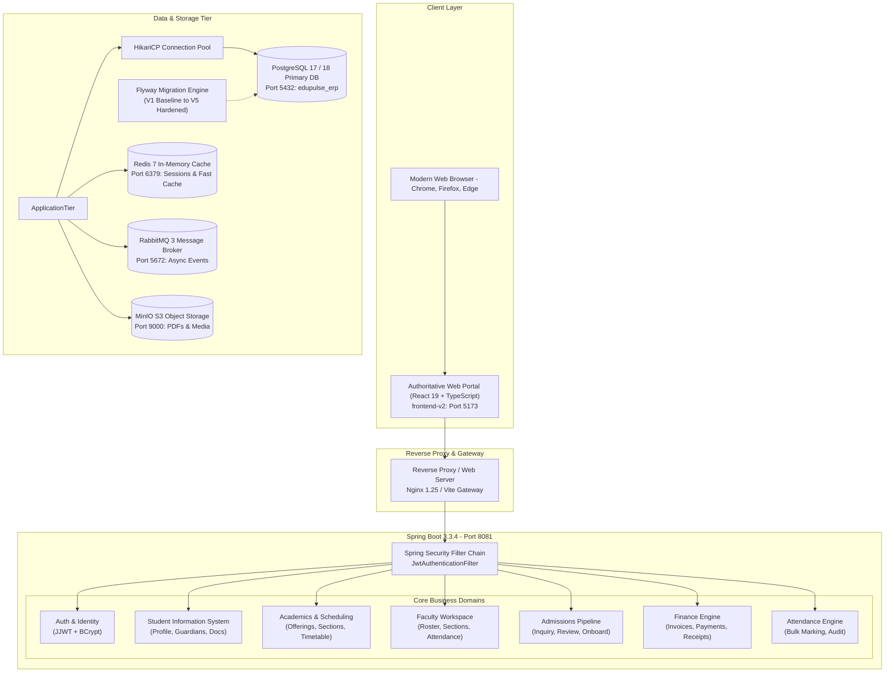
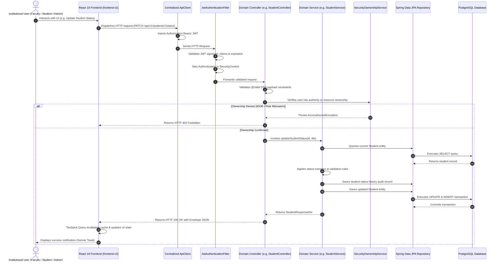

# Institutional ERP v1.0 — System Architecture & Technical Design

## 1. Architectural Philosophy: The Modular Monolith

Institutional ERP v1.0 is engineered as a **cohesive, domain-partitioned modular monolith**. Rather than introducing the operational complexity and distributed network overhead of microservices prematurely, the application encapsulates discrete business domains within clearly demarcated Spring Boot modules while sharing a unified transactional database engine and security perimeter.

### Why Modular Monolith?
- **Transactional Consistency:** Critical institutional workflows (such as student onboarding, course section allocation, and fee payment recording) execute within atomic, ACID-compliant database transactions without two-phase commit overhead.
- **Strict Boundary Enforcement:** Domain packages (`student`, `faculty`, `academic`, `admission`, `finance`, `attendance`, `auth`) interact through strongly typed DTOs and well-defined service interfaces rather than raw entity exposure.
- **Simplified Operational Topology:** A single containerized Spring Boot backend service pairs with an authoritative single-page application (SPA), drastically reducing infrastructure maintenance costs.

---

## 2. High-Level System Architecture Diagram

---

## 3. Layered Application Design

### 3.1 Presentation Layer (Authoritative Frontend: `frontend-v2/`)
- **Technology:** React 19, TypeScript ~6.0, Vite 8, Tailwind CSS, Radix UI Primitives.
- **State Management:**
  - **Server State:** TanStack Query v5 (`@tanstack/react-query`) with automatic background invalidation, stale-while-revalidate caching, and optimistic UI updates.
  - **Client State:** Zustand (`useAuthStore`) storing authentication tokens, active role claims, and user metadata in `localStorage`.
- **Component System:** Headless, highly accessible UI components built with Radix UI (`Dialog`, `DropdownMenu`, `Select`, `Slot`) styled via Tailwind CSS utility classes and Lucide icons.
- **Form Handling:** React Hook Form coupled with Zod schema validation for strict client-side contract checking before network dispatch.

### 3.2 Security & Filter Chain Layer
- **Token Format:** Cryptographically signed JSON Web Tokens (JJWT 0.11.5) using HMAC-SHA256 (`HS256`).
- **Authentication Filter:** `JwtAuthenticationFilter` intercepts incoming requests:
  1. Extracts `Authorization: Bearer <token>` header.
  2. Validates token signature and expiration against server secret.
  3. Queries `CustomUserDetailsService` / `SessionService`.
  4. Injects `UsernamePasswordAuthenticationToken` into `SecurityContextHolder`.
- **Authorization Enforcement:** Method-level security via `@EnableMethodSecurity` and `@PreAuthorize("hasRole('...') or hasAuthority('...')")` on every controller method.
- **Resource Ownership & IDOR Protection:** `SecurityOwnershipService` and `StudentIdentityService` ensure that authenticated users cannot access or alter resources belonging to other identities.

### 3.3 Domain Service Layer
- **Encapsulated Business Rules:** Pure Java services (`StudentServiceImpl`, `FacultyServiceImpl`, `PaymentServiceImpl`, `AdmissionServiceImpl`) implement transactional workflows annotated with `@Transactional`.
- **DTO Isolation:** Entity objects (`Student`, `AppUser`, `FeePayment`) are strictly isolated within the persistence tier and never exposed directly over HTTP. All inputs and outputs utilize dedicated DTOs (`StudentRequestDto`, `StudentResponseDto`, `PaymentRequestDto`).
- **Auditing & History:** Domain status updates (e.g. `StudentStatus`) automatically persist immutable audit snapshots to tracking tables (`student_status_history`).

### 3.4 Persistence & Database Migration Layer
- **JPA & Hibernate:** Spring Data JPA with custom Spring Data repository interfaces (`StudentRepository`, `FeePaymentRepository`).
- **Database Migration:** Managed exclusively via Flyway:
  - `V1__baseline_erp_schema.sql`: Core university data schema (20+ normalized relational tables).
  - `V2__persistent_user_management.sql`: Enterprise user authentication entity schema.
  - `V3__enforce_faculty_fk.sql`: Strict foreign key constraint linking faculty records to departments.
  - `V4__link_users_to_domain_entities.sql`: Structural backfill linking authentication accounts to domain actors.
  - `V5__payment_idempotency.sql`: Cryptographic idempotency keys and balance integrity safeguards.
- **Database Safety Guards:** Integrated fail-fast test guards (`PostgresSafetyGuard`) prevent automated tests from ever running against protected operational databases (`edupulse_erp` or `one`).

---

## 4. End-to-End Request Lifecycle Sequence

---

## 5. Security & Concurrency Architecture

### 5.1 Payment Idempotency Engine
To prevent double-billing during financial network retries, payment requests require an `Idempotency-Key` header. The database enforces uniqueness on `fee_payments.idempotency_key`. A duplicate submission triggers an HTTP 409 Conflict or returns the cached successful receipt, guaranteeing zero duplicate ledger posts.

### 5.2 Section Capacity Safeguards
Course registration operations implement pessimistic/optimistic locking checks on section enrollment counts. If a course section's physical seat cap (`max_capacity`) is reached, concurrent registration attempts fail gracefully with informative error payloads rather than over-allocating seats.
