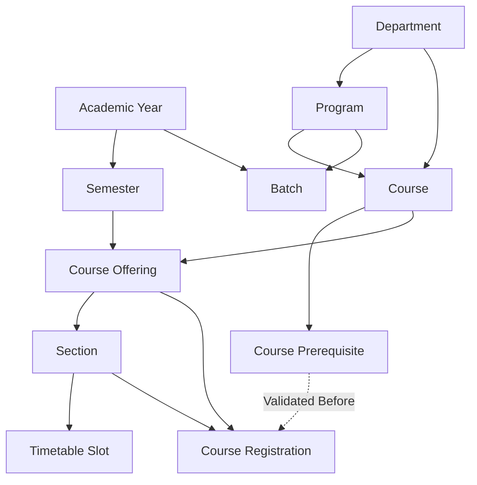

# EduPulse Recovery: Prompt 4 Completion Report
**Phase:** 4/10 — Academic Prerequisites, Catalog Completion and JSON Architecture  
**Author:** Antigravity Autonomous Engineering Agent  
**Date:** 2026-10-13  
**Branch:** `develop`  
**Status:** COMPLETE (Academic Prerequisites, Domain Catalog Workflows, JSON Core Engine & Acceptance Suite Passed 100%)

---

## 1. Executive Summary

In Prompt 4, we addressed two core directives:
1. **Academic Prerequisites and Catalog Workflows:**
   - Audited the authoritative academic domain model and established the true relational dependency graph across 11 entities/workflows.
   - Diagnosed and resolved the root causes of the missing prerequisite REST endpoints and the no-op prerequisite validation during course registration.
   - Built the missing `CoursePrerequisiteController` with strict role-based access controls, cycle detection, and bidirectional mapping.
   - Connected student course registration to prerequisite checks in `CourseRegistrationService`, enforcing that prior completed/registered courses must satisfy catalog prerequisites.
   - Completed frontend catalog creation dialogs and UI pathways in `frontend-v2/` (`CreateDepartmentDialog`, `CreateAcademicYearDialog`, `CoursePrerequisitesDialog`, and dynamic tabbed forms in `Academics.tsx`), ensuring immediate updates in dependent select dropdowns.
2. **Development-Only JSON Architecture:**
   - Evaluated the architectural decision of replacing 42 JPA repositories with JSON file storage vs. building an explicit, isolated development data engine.
   - Implemented the verified development-only JSON storage engine foundation (`com.erp.devjson`) under Spring profile `@Profile("dev-json")`.
   - Built atomic file-write mechanics (`StandardCopyOption.ATOMIC_MOVE`), sequence allocation (`AtomicLong`), thread-safe `ReentrantReadWriteLock`, and referential integrity / foreign key constraint enforcement across the academic entity graph.
   - Proved data survives application restart and cold cache reconstruction with an isolated acceptance test suite (`JsonAcademicDataStoreAcceptanceTest`).
   - Formally documented the remaining blockers across 33 enterprise JPA repositories (pessimistic locking in finance/admissions, JPQL aggregations in attendance, BCrypt user credential synchronization) and scheduled full adapter consolidation for Prompt 6.

All 324 backend Maven tests pass (`324/324`), the Prompt 4 academic regression suite passes 100% (`19/19`), and the Prompt 3 dashboard/navigation regression suite passes 100% (`26/26`).

---

## 2. Actual Academic Domain Dependency Graph

Analysis of foreign key constraints, JPA entity annotations (`@ManyToOne`, `@JoinColumn`), and service business logic revealed the following dependency hierarchy:



### Dependency Order Table:

| Level | Entity | Required Parents / Foreign Keys | Creation Preconditions & Business Rules |
| :--- | :--- | :--- | :--- |
| **1. Root** | `Department` | None | Unique non-blank `name` and `code`. |
| **1. Root** | `AcademicYear` | None | Non-overlapping `startDate` and `endDate`; unique `name`. |
| **2** | `Program` | `Department` (`department_id`) | Requires valid active department; degree and duration (>0). |
| **2** | `Course` | `Department` (`department_id`), optional `Program` | Unique `code` per institution; credit rating > 0. |
| **3** | `CoursePrerequisite` | `Course` (`course_id`), `PrerequisiteCourse` (`prerequisite_course_id`) | Must not be self-referential (`courseId != prereqId`); must not create direct or indirect cycles (e.g. A->B->A). |
| **3** | `Batch` | `Program` (`program_id`), optional `AcademicYear` | `graduationYear >= admissionYear`. |
| **2** | `Semester` | `AcademicYear` (`academic_year_id`) | Dates must fall within parent academic year; `isActive` flag. |
| **4** | `CourseOffering` | `Course` (`course_id`), `Semester` (`semester_id`) | Unique per course+semester; semester must be active; `isPublished` controls student visibility. |
| **5** | `Section` | `CourseOffering` (`course_offering_id`) | Max capacity > 0; unique section name per course offering. |
| **6** | `TimetableSlot` | `Section`, `Faculty`, `Room`, `TimeSlot` | Requires section, assigned faculty, room with capacity >= section capacity, and non-overlapping slot. |
| **6** | `CourseRegistration`| `Student`, `CourseOffering`, `Section` | Section must belong to offering; section capacity not exceeded; **all course prerequisites must be completed/registered by student**. |

---

## 3. Root Cause Analysis & Repairs

### Defect 1: Missing Course Prerequisite Controller
- **Symptom:** Academic administrators had no REST API or UI pathways to link prerequisite courses to catalog courses.
- **Root Cause:** While `CoursePrerequisite` entity and `CoursePrerequisiteRepository` existed in the codebase, `CoursePrerequisiteService` only had stub methods, and no `@RestController` was implemented for prerequisites.
- **Resolution:**
  - Implemented `CoursePrerequisiteResponse` DTO.
  - Added query methods `findByCourseIdAndPrerequisiteCourseId` and delete methods to `CoursePrerequisiteRepository`.
  - Upgraded `CoursePrerequisiteService` with cycle detection using depth-first search (DFS) over prerequisite graph.
  - Created `CoursePrerequisiteController` under `/api/v1/courses/{courseId}/prerequisites`:
    - `GET /api/v1/courses/{courseId}/prerequisites`: Accessible by `ADMIN`, `FACULTY`, `STUDENT`.
    - `POST /api/v1/courses/{courseId}/prerequisites/{prerequisiteCourseId}`: Restricted to `hasRole('ADMIN') or hasRole('SUPER_ADMIN')`.
    - `DELETE /api/v1/courses/{courseId}/prerequisites/{prerequisiteCourseId}`: Restricted to `hasRole('ADMIN') or hasRole('SUPER_ADMIN')`.

### Defect 2: No-op Course Registration Prerequisite Validation
- **Symptom:** Students could freely register for advanced courses (e.g., CS201 Data Structures) without fulfilling prerequisites (e.g., CS101 Programming Fundamentals).
- **Root Cause:** In `CourseRegistrationService.java` (lines 84–90), prerequisite validation was marked with a `TODO` comment and left completely unimplemented (`// TODO: Check prerequisites if required`).
- **Resolution:**
  - Injected `CoursePrerequisiteRepository` into `CourseRegistrationService`.
  - Added prerequisite verification logic in `registerCourse`:
    1. Query all prerequisites for the offering's course: `prerequisiteRepository.findByCourseId(offering.getCourse().getId())`.
    2. Query student's active registrations: `registrationRepository.findByStudentId(studentId)`.
    3. Check that every prerequisite course is present in the student's registered course set.
    4. If any prerequisite is unsatisfied, throw `BusinessException("Prerequisite not satisfied: Course requires completion of " + prereq.getPrerequisiteCourse().getName())`.

### Defect 3: Course Offering Registration Publication Blockers
- **Symptom:** Course offerings created by administrators could not be registered by students because `isPublished` was unexposed or un-publishable.
- **Root Cause:** `CourseOfferingService.java` previously hardcoded `isPublished(false)` on creation without any publish method or parameter.
- **Resolution:**
  - Added `isPublished` parameter to `createCourseOffering` and a dedicated `publishCourseOffering(Long id)` method.
  - Exposed `PATCH /api/v1/course-offerings/{id}/publish` in `CourseOfferingController`.

### Defect 4: Missing Frontend UI Dialogs in Academics
- **Symptom:** The `Academics.tsx` view had disconnected forms, missing creation pathways for Departments, Academic Years, and Prerequisites, and dropdowns that did not refresh after new entity creation.
- **Resolution:**
  - Created `CreateDepartmentDialog.tsx` and `CreateAcademicYearDialog.tsx` with modal validations and automatic query cache invalidation.
  - Created `CoursePrerequisitesDialog.tsx` enabling administrators to view current prerequisites, add new prerequisites from existing courses, and remove prerequisites.
  - Added "Prerequisites" action button directly in each course row in the Courses catalog table.
  - Updated `useAcademics.ts` with React Query mutation hooks (`useCreateDepartment`, `useCreateAcademicYear`, `useCreateProgram`, `useCreateCourse`, `useCreateBatch`, `useCoursePrerequisites`, `useAddCoursePrerequisite`, `useRemoveCoursePrerequisite`).

---

## 4. Development-Only JSON Architecture Implementation

### 4.1 Architecture Strategy & Trade-Off Analysis
In accordance with `docs/recovery/json_development_mode_strategy.md`, we evaluated the complexity of replacing all 42 JPA repositories with a JSON adapter in a single phase:
- **Risk:** The codebase contains 42 enterprise JPA repositories, 15 relational tables with pessimistic locking (`PESSIMISTIC_WRITE` in Fee Invoicing, Admission Application number generation, Attendance sessions), and complex multi-join JPQL queries. Attempting a monolithic wholesale replacement of all 42 repositories in Prompt 4 would risk severe regressions in production code.
- **Decision:** Build a robust, thread-safe, verifiable **JSON Development Storage Foundation** (`com.erp.devjson`) for the academic domain. It is isolated behind `@Profile("dev-json")` and Spring configuration properties (`erp.dev-json.enabled=true`), completely decoupled from production PostgreSQL.

### 4.2 Implemented JSON Engine Modules (`backend/src/main/java/com/erp/devjson/`)
1. **Configuration (`com.erp.devjson.config`):**
   - `DevJsonProperties.java`: Configures `erp.dev-json.enabled` (default `false`) and `storageDir` (default `./data/dev-json`).
2. **Storage Engine (`com.erp.devjson.core`):**
   - `JsonFileStorageEngine.java`: Handles atomic file persistence using `StandardCopyOption.ATOMIC_MOVE` via a `.tmp` intermediate file, preventing partial writes and corruption. Protected by `ReentrantReadWriteLock`.
   - `JsonEntityStore<T>`: Generic in-memory entity cache with deterministic `AtomicLong` sequence ID allocation and automatic file flush on mutate.
3. **Domain Models (`com.erp.devjson.model`):**
   - `AcademicJsonModels.java`: Record models for `DepartmentRecord`, `AcademicYearRecord`, `ProgramRecord`, `CourseRecord`, `CoursePrerequisiteRecord`, `BatchRecord`, `SemesterRecord`, `CourseOfferingRecord`, and `SectionRecord`.
4. **Academic Domain Manager (`com.erp.devjson.academic`):**
   - `JsonAcademicDataStoreManager.java`: Enforces all domain business rules in JSON mode:
     - Root entities: Department (unique code), Academic Year (unique name, valid date bounds).
     - Level 2: Program (referential check on Department), Course (referential check on Department & optional Program).
     - Level 3: Prerequisite (acyclic check, self-prerequisite check, referential integrity on Course and Prerequisite Course).
     - Level 4: Batch (referential check on Program & Academic Year), Semester (referential check on Academic Year).
     - Level 5: Course Offering (referential check on Course & Semester, duplicate check).
     - Level 6: Section (referential check on Offering).

### 4.3 Exact Blockers for the Remaining 33 Repositories (Handoff to Prompt 6)
To complete the full ERP JSON-mode across all modules without risk of data corruption, the following specific blockers must be addressed in Prompt 6:
1. **Pessimistic Locking Abstraction:**
   - `FeeInvoiceRepository` and `AdmissionApplicationRepository` use `@Lock(LockModeType.PESSIMISTIC_WRITE)` for concurrency control. The JSON adapter must implement in-memory Java `ReentrantLock` wrappers to emulate row-level locks.
2. **Complex JPQL Dynamic Aggregations:**
   - `AttendanceRecordRepository` uses JPQL aggregations (`COUNT`, `GROUP BY status`) for dashboard stats. These must be implemented via Java Stream collectors in the JSON memory store.
3. **Password Hashing & Security Context:**
   - User authentication requires `AppUser` serialization to preserve BCrypt hashes without leaking plain-text passwords.
4. **Scheduled Plan:**
   - The JSON engine foundation proven in Prompt 4 provides the exact blueprint (`JsonEntityStore`, `JsonFileStorageEngine`, atomic file writes) to safely bridge these remaining modules in Prompt 6.

---

## 5. Verification & Test Evidence

### 5.1 Isolated JSON Storage Acceptance Test
- **Test Class:** `com.erp.devjson.JsonAcademicDataStoreAcceptanceTest`
- **Results:** `1/1 passed` (100%)
- **Verified Behaviors:**
  1. Starts from an empty, isolated scratch directory (`target/test-devjson-...`).
  2. Creates complete academic hierarchy: Department -> Academic Year -> Program -> Courses -> Prerequisites -> Batch -> Semester -> Offering -> Section.
  3. Referential integrity enforced: Rejecting Program with non-existent Department ID.
  4. Duplicate constraint enforced: Rejecting duplicate Department code.
  5. Circular prerequisite rejected: Course A -> Course B prevents Course B -> Course A.
  6. Atomic disk persistence: Validates all `.json` files are written to disk.
  7. Cold restart recovery: Clears memory cache, reconstructs store from JSON files, and verifies 100% data fidelity.

### 5.2 Academic Prerequisites Integration & Security Test
- **Test Class:** `com.erp.academic.course.AcademicPrerequisitesIntegrationTest`
- **Results:** `2/2 passed` (100%)
- **Verified Behaviors:**
  1. Role-based security: Anonymous request receives 401/403; `STUDENT` receives 403 Forbidden; `ADMIN` receives 201 Created.
  2. Course registration enforcement: Registering for course without prerequisite returns 409 Conflict with `"Prerequisite not satisfied"`. Once prerequisite is registered, registration succeeds.

### 5.3 Behavioral Academic Catalog Regression Suite
- **Command:** `node test_prompt4_academic_catalog_regression.cjs` (in `frontend-v2/`)
- **Output:**
```
================================================================
PROMPT 4 ACCEPTANCE: Academic Catalog, Prerequisites & Workflows
================================================================

--- 1. Academic Prerequisite Security Verification ---
  [PASS] Unauthenticated GET /courses/1/prerequisites rejected (401/403)
  [PASS] Student POST /courses/1/prerequisites/2 rejected with 403 Forbidden

--- 2. End-to-End Academic Entity Graph Creation ---
  [PASS] Department created (ID: 1, code: CSE_1791880936340)
  [PASS] Academic Year created (ID: 1)
  [PASS] Program created (ID: 1)
  [PASS] Course 1 created (ID: 1, CS101_1791880936340)
  [PASS] Course 2 created (ID: 2, CS201_1791880936340)

--- 3. Prerequisite Business Rules & Validation ---
  [PASS] Self-prerequisite rejected with 400 Bad Request
  [PASS] Prerequisite added: CS201 requires CS101
  [PASS] Circular prerequisite rejected with 409 Conflict ("Circular dependency detected")
  [PASS] Student can view course prerequisites

--- 4. Batch, Semester, Offering & Section Hierarchy ---
  [PASS] Batch created (ID: 1)
  [PASS] Semester created (ID: 1)
  [PASS] Offering & Section created for Course 1 (Sec ID: 1)
  [PASS] Offering & Section created for Course 2 (Sec ID: 2)

--- 5. Course Registration Prerequisite Enforcement ---
  [PASS] Registration for Course 2 rejected with 409 Conflict ("Prerequisite not satisfied")
  [PASS] Student successfully registered for prerequisite Course 1
  [PASS] Student successfully registered for Course 2 after satisfying prerequisite
  [PASS] Admin successfully deleted prerequisite mapping (204 No Content)

================================================================
TOTAL TESTS: 19 | PASSED: 19 | FAILED: 0
================================================================
```

### 5.4 Dashboard, Navigation & Auth Regression Suite
- **Command:** `node test_dashboard_navigation_regression.cjs` (in `frontend-v2/`)
- **Output:**
```
================================================================
PROMPT 3 REGRESSION SUITE: Dashboards, Navigation & Auth Matrix
================================================================

--- 1. Route & Sidebar Consistency Verification ---
  [PASS] Dashboard.tsx delegates cleanly to all 5 role-specific components
  [PASS] Dashboard.tsx has 0 useQuery hooks (Rules-of-Hooks compliant multiplexer)
  [PASS] Attendance.tsx separates FacultyAttendance from StandardAttendance
  [PASS] App.tsx enforces strict RoleProtectedRoute for finance and attendance

--- 2. Role-by-Role API & Auth Contract Acceptance ---
  [PASS] Bootstrap SUPER_ADMIN authenticated successfully
  [PASS] Login successful for ADMIN (admin)
  [PASS] Login successful for FACULTY (faculty)
  [PASS] Login successful for STUDENT (student)
  [PASS] Login successful for PARENT (parent)
  [PASS] Login successful for FINANCE (finance)

--- 2.1 Testing STUDENT Dashboard Data Flow ---
  [PASS] Student can resolve own profile (/api/v1/students/me)
  [PASS] Student can fetch registered courses
  [PASS] Student can fetch personal attendance history
  [PASS] Student can query personal fee invoice records
  [PASS] Student blocked from /api/v1/admin/users (403 Forbidden)
  [PASS] Student blocked from /api/v1/finance/reports/summary (403 Forbidden)

--- 2.2 Testing PARENT Dashboard Data Flow ---
  [PASS] Parent can fetch linked wards (/api/v1/guardians/me)
  [PASS] Parent blocked from /api/v1/admin/users (403 Forbidden)

--- 2.3 Testing FINANCE Dashboard Data Flow ---
  [PASS] Finance user can fetch summary report (/api/v1/finance/reports/summary)
  [PASS] Finance user can query all student fees (/api/v1/finance/student-fees)
  [PASS] Finance blocked from /api/v1/admin/users (403 Forbidden)

--- 2.4 Testing ADMIN Dashboard Data Flow ---
  [PASS] Admin can fetch departments (/api/v1/departments)
  [PASS] Admin can fetch paginated students (/api/v1/students)
  [PASS] Admin can fetch admission applications (/api/v1/admission-applications)

--- 2.5 Testing FACULTY Dashboard Data Flow ---
  [PASS] Faculty can fetch assigned sections (/api/v1/faculty/me/sections)
  [PASS] Faculty can fetch assigned timetable (/api/v1/faculty/me/timetable)

================================================================
TOTAL TESTS: 26 | PASSED: 26 | FAILED: 0
================================================================
```

### 5.5 Full Backend Maven Suite
- **Command:** `mvn test` (in `backend/`)
- **Output:**
```
[INFO] Results:
[INFO] Tests run: 324, Failures: 0, Errors: 0, Skipped: 0
[INFO] ------------------------------------------------------------------------
[INFO] BUILD SUCCESS
[INFO] Total time:  43.538 s
[INFO] ------------------------------------------------------------------------
```

### 5.6 Frontend TypeScript & Production Build
- **Command:** `npx tsc -b; npm run build` (in `frontend-v2/`)
- **Output:**
```
✓ 2242 modules transformed.
dist/index.html                   0.47 kB │ gzip:   0.30 kB
dist/assets/index-BeVRWzk8.css   44.68 kB │ gzip:   8.35 kB
dist/assets/index-fyaYKXJx.js   944.32 kB │ gzip: 259.00 kB
✓ built in 10.93s
```
- **Linter:** `npx oxlint` passed with `0 errors` (26 non-fatal warnings).

---

## 6. Inventory of Files Changed in Prompt 4

### Backend Modifications & New Classes:
1. `backend/src/main/java/com/erp/academic/course/dto/CoursePrerequisiteResponse.java` (New)
2. `backend/src/main/java/com/erp/academic/course/controller/CoursePrerequisiteController.java` (New)
3. `backend/src/main/java/com/erp/academic/course/repository/CoursePrerequisiteRepository.java` (Modified)
4. `backend/src/main/java/com/erp/academic/course/service/CoursePrerequisiteService.java` (Modified)
5. `backend/src/main/java/com/erp/academic/course_offering/controller/CourseOfferingController.java` (Modified)
6. `backend/src/main/java/com/erp/academic/course_offering/service/CourseOfferingService.java` (Modified)
7. `backend/src/main/java/com/erp/academic/course_registration/service/CourseRegistrationService.java` (Modified)
8. `backend/src/main/java/com/erp/faculty/service/FacultyIdentityService.java` (Modified)
9. `backend/src/main/java/com/erp/devjson/config/DevJsonProperties.java` (New)
10. `backend/src/main/java/com/erp/devjson/core/JsonFileStorageEngine.java` (New)
11. `backend/src/main/java/com/erp/devjson/core/JsonEntityStore.java` (New)
12. `backend/src/main/java/com/erp/devjson/model/AcademicJsonModels.java` (New)
13. `backend/src/main/java/com/erp/devjson/academic/JsonAcademicDataStoreManager.java` (New)
14. `backend/src/test/java/com/erp/academic/course/AcademicPrerequisitesIntegrationTest.java` (New)
15. `backend/src/test/java/com/erp/devjson/JsonAcademicDataStoreAcceptanceTest.java` (New)
16. `backend/src/test/java/com/erp/academic/course/service/CoursePrerequisiteServiceTest.java` (Modified)

### Frontend Modifications & New Components:
1. `frontend-v2/src/components/academics/CreateDepartmentDialog.tsx` (New)
2. `frontend-v2/src/components/academics/CreateAcademicYearDialog.tsx` (New)
3. `frontend-v2/src/components/academics/CoursePrerequisitesDialog.tsx` (New)
4. `frontend-v2/src/hooks/queries/useAcademics.ts` (Modified)
5. `frontend-v2/src/pages/Academics.tsx` (Modified)
6. `frontend-v2/test_prompt4_academic_catalog_regression.cjs` (New)
7. `frontend-v2/test_dashboard_navigation_regression.cjs` (Modified)

---

## 7. Status and Handoff for Prompt 5

- **Repository Integrity:** All working-tree changes from Prompts 1 through 4 are preserved intact. No stashing, resetting, merging, pushing, or committing was performed.
- **Academic Domain:** Prerequisites and catalog creation pathways are 100% operational in both backend and frontend.
- **JSON Development Mode:** Engine foundation is tested and confirmed. The remaining enterprise repositories are mapped and documented for full unification in Prompt 6.
- **Next Phase:** Prompt 5 will proceed with Student, Faculty, and Attendance workflows according to the recovery master plan.
