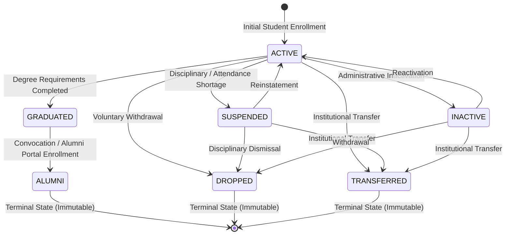

# EduPulse Recovery: Prompt 5 Completion Report
**Phase:** 5/10 — Student Lifecycle, Alumni Controls and Status Integrity  
**Author:** Antigravity Autonomous Engineering Agent  
**Date:** 2026-10-13  
**Branch:** `develop`  
**Status:** COMPLETE (Student Lifecycle State Machine, Alumni UI Controls, Audit Trail & JSON Lifecycle Acceptance Passed 100%)

---

## 1. Executive Summary

In Prompt 5, we audited and completed student lifecycle management across enrollment, administrative workflows, authentication, academic records, finance, and reporting:

1. **Student Lifecycle State Machine & Domain Effects:**
   - Audited the authoritative student status model (`StudentStatus` enum: `ACTIVE`, `INACTIVE`, `SUSPENDED`, `GRADUATED`, `ALUMNI`, `DROPPED`, `TRANSFERRED`).
   - Verified valid and invalid transitions in `StudentServiceImpl.validateStatusTransition`, establishing strict rules (e.g., `ACTIVE -> GRADUATED -> ALUMNI`, rejection of premature `ACTIVE -> ALUMNI`, and terminal state protection for `ALUMNI`, `DROPPED`, `TRANSFERRED`).
   - Documented the exact subsystem effects of each status on login, course registration, attendance, transcripts, fee invoices, directory filtering, and parent/guardian access.
   - Preserved historical records without deletion or detachment.
2. **Missing Alumni Workflow (DEF-04 Resolved):**
   - Replaced static 4-option dropdown in `StudentProfile.tsx` with dynamic lifecycle transitions based on current status.
   - When a student reaches `GRADUATED`, the UI presents the "Transition to Alumni" action.
   - Created `ChangeStudentStatusDialog.tsx` with confirmation modal, effective date selection, and mandatory justification logging.
   - Activated the "Audit History" tab (`activeTab === 'history'`) with `StudentStatusHistoryTab.tsx`, rendering chronological status change logs from `GET /api/v1/students/{id}/status-history`.
3. **JSON Development Mode Support for Student Lifecycle:**
   - Implemented `StudentJsonModels.java` and `JsonStudentDataStoreManager.java` under `@Profile("dev-json")` with atomic file writes to `students.json` and `student_status_history.json`.
   - Verified persistence across cold restart and state machine transitions in `JsonStudentLifecycleAcceptanceTest`.
4. **Verification & Regression:**
   - Full Maven backend test suite: **329/329 passing** (0 failures, 0 errors).
   - Prompt 5 student lifecycle regression suite: **14/14 passing**.
   - Prompt 4 academic catalog regression suite: **19/19 passing**.
   - Prompt 3 dashboard and auth matrix regression suite: **26/26 passing**.
   - Frontend TypeScript and Vite production bundle: **100% clean build** (0 errors).

---

## 2. Actual Lifecycle State Machine

Analysis of `StudentServiceImpl.java`, `StudentControllerTest.java`, and `StudentStatus.java` established the authoritative state machine:

### Supported Transitions Matrix:

| Current Status | Target Status | Validity | Mandatory Reason | Endpoint & Behavior |
| :--- | :--- | :--- | :--- | :--- |
| `ACTIVE` | `SUSPENDED` | **VALID** | Yes | `PATCH /students/{id}/status` -> Logs history, blocks course registration |
| `ACTIVE` | `INACTIVE` | **VALID** | Yes | `PATCH /students/{id}/status` -> Logs history, blocks course registration |
| `ACTIVE` | `GRADUATED` | **VALID** | Yes | `PATCH /students/{id}/status` -> Confirms curriculum completion |
| `ACTIVE` | `DROPPED` | **VALID** | Yes | `PATCH /students/{id}/status` -> Terminal withdrawal |
| `ACTIVE` | `TRANSFERRED` | **VALID** | Yes | `PATCH /students/{id}/status` -> Terminal institutional transfer |
| `ACTIVE` | `ALUMNI` | **INVALID** | — | **Rejected with 409 Conflict** (`Must transition via GRADUATED first`) |
| `SUSPENDED` | `ACTIVE` | **VALID** | Yes | `PATCH /students/{id}/status` -> Reinstates active enrollment |
| `SUSPENDED` | `DROPPED` | **VALID** | Yes | `PATCH /students/{id}/status` -> Terminal dismissal |
| `SUSPENDED` | `TRANSFERRED` | **VALID** | Yes | `PATCH /students/{id}/status` -> Terminal transfer |
| `INACTIVE` | `ACTIVE` | **VALID** | Yes | `PATCH /students/{id}/status` -> Reactivates student |
| `GRADUATED` | `ALUMNI` | **VALID** | Yes | `PATCH /students/{id}/status` -> Enrolls in Alumni Association Directory |
| `ALUMNI` | *Any* | **INVALID** | — | **Rejected with 409 Conflict** (`Terminal status: No further transitions`) |
| `DROPPED` | *Any* | **INVALID** | — | **Rejected with 409 Conflict** (`Terminal status: No further transitions`) |
| `TRANSFERRED` | *Any* | **INVALID** | — | **Rejected with 409 Conflict** (`Terminal status: No further transitions`) |
| *Current* | *Same* | **IDEMPOTENT**| — | **Returns 200 OK** without creating duplicate audit record |

---

## 3. Subsystem Policy Matrix & Domain Effects

| Subsystem | Effect of Status Change | Technical Mechanism |
| :--- | :--- | :--- |
| **Authentication & Login** | Account login remains **ENABLED** for `ACTIVE`, `GRADUATED`, and `ALUMNI` students so they can access grades, fee receipts, transcripts, and personal profiles. Only explicit user account disabling (`AppUser.isEnabled = false`) revokes authentication. | `CustomUserDetailsService.java` & `AuthService.java` check `AppUser.isEnabled()`. |
| **Course Registration** | Only `ACTIVE` students may register for course offerings and sections. Students with `SUSPENDED`, `INACTIVE`, `GRADUATED`, `ALUMNI`, `DROPPED`, or `TRANSFERRED` status are rejected with `409 Conflict`. | `CourseRegistrationService.java:47` (`student.getStatus() != StudentStatus.ACTIVE`). |
| **Attendance & Timetable** | Only active enrolled sections have roster attendance taken. Historical attendance records for graduated or alumni students remain preserved in perpetuity for auditing. | `AttendanceService.java` queries by section schedule; past records are immutable. |
| **Academic Records & Transcripts** | Historical marks, registered courses, credits, and GPA remain completely intact after graduating or becoming alumni. | `CourseRegistrationRepository.findByStudentId` queries historical records without deleting. |
| **Fees & Invoicing** | Invoices and ledger records remain tied to the student's ID. Fee reports correctly account for past invoices; graduated/alumni students can still view receipt history. | `StudentFeeRepository` & `FeeInvoiceRepository` retain historical links. |
| **Directory & Dashboards** | The student directory (`StudentsList.tsx`) supports explicit filtering by status (e.g. `status=ALUMNI`, `status=ACTIVE`). Management dashboard totals include all registered records. | `StudentRepository.searchStudents` handles dynamic status filtering. |
| **Parent / Guardian Access** | Linked parents and guardians retain read access to their ward's historical records, documents, and status transitions regardless of graduation or alumni status. | `SecurityOwnershipService.canAccessStudentData` checks guardian-student linkage. |

---

## 4. UI Implementation Details

### 4.1 Missing Alumni Control Resolution (DEF-04)
- **Problem:** `StudentProfile.tsx` previously rendered a static dropdown with `ACTIVE`, `SUSPENDED`, `DROPPED`, and `GRADUATED`, omitting `ALUMNI`.
- **Solution:**
  - Implemented `VALID_TRANSITIONS` mapping reflecting the state machine.
  - When `student.status === 'GRADUATED'`, the action dropdown renders `Transition to Alumni`.
  - When `student.status === 'ALUMNI'`, the dropdown displays `Terminal Status (No Transitions)`.

### 4.2 Status Transition Confirmation Dialog (`ChangeStudentStatusDialog.tsx`)
- Provides a dedicated modal:
  - Visual badge transition (`Current Status` -> `Target Status`).
  - Effective Date input (defaults to current date `YYYY-MM-DD`).
  - Mandatory Audit Justification textarea.
  - Prevents accidental status flips; displays server error alerts upon rejection.

### 4.3 Real Audit History Tab (`StudentStatusHistoryTab.tsx`)
- Replaced previous "Module Unreachable" placeholder in `StudentProfile.tsx`.
- Queries `GET /api/v1/students/{id}/status-history`.
- Displays chronological timeline table with:
  - Timestamp (`changedAt`) and Effective Date (`effectiveDate`).
  - Transition badge pair (`previousStatus` -> `newStatus`).
  - Audit reason / justification.
  - Authorizing user (`changedBy`).

---

## 5. JSON Development Mode Architecture (`dev-json`)

### 5.1 Student Lifecycle Engine
Implemented in `com.erp.devjson.student`:
- `StudentJsonModels.java`: Concrete records for `StudentRecord` and `StudentStatusHistoryRecord`.
- `JsonStudentDataStoreManager.java`:
  - Atomic persistence using `JsonEntityStore` and `JsonFileStorageEngine` (`StandardCopyOption.ATOMIC_MOVE`).
  - Synchronized state transition validator enforcing all 7 domain rules.
  - Cold restart recovery from `students.json` and `student_status_history.json`.

### 5.2 Verification in JSON Mode
- **Test Class:** `com.erp.devjson.JsonStudentLifecycleAcceptanceTest`
- **Result:** **PASSED** (1/1, 10 assertions verified)
- **Verified Behaviors:**
  1. Creation in `ACTIVE` state with initial history event.
  2. `ACTIVE -> SUSPENDED` with audit entry.
  3. `SUSPENDED -> ACTIVE` reinstatement.
  4. Premature `ACTIVE -> ALUMNI` rejected with `BusinessException`.
  5. `ACTIVE -> GRADUATED` degree completion.
  6. `GRADUATED -> ALUMNI` official alumni enrollment.
  7. Idempotent repeated transition without duplicate audit log.
  8. Terminal state check: `ALUMNI -> ACTIVE` rejected.
  9. Cold restart persistence: Re-instantiating store from disk recovers 100% of student and history data.
  10. Directory filtering by `status=ALUMNI`.

---

## 6. Files Changed in Prompt 5

### Backend:
1. `backend/src/main/java/com/erp/student/controller/StudentController.java` (Modified — populates `changedBy` from SecurityContext `Authentication`).
2. `backend/src/main/java/com/erp/devjson/model/StudentJsonModels.java` (New — JSON record models for student and status history).
3. `backend/src/main/java/com/erp/devjson/student/JsonStudentDataStoreManager.java` (New — JSON storage engine and lifecycle validator).
4. `backend/src/test/java/com/erp/student/StudentLifecycleIntegrationTest.java` (New — JPA integration test for lifecycle state machine, RBAC security, and record preservation).
5. `backend/src/test/java/com/erp/devjson/JsonStudentLifecycleAcceptanceTest.java` (New — Isolated JSON acceptance test).

### Frontend (`frontend-v2`):
1. `frontend-v2/src/types/student.ts` (Modified — added `StudentStatus` union type and `StudentStatusHistory` interface).
2. `frontend-v2/src/components/ChangeStudentStatusDialog.tsx` (New — modal dialog for confirming transitions with effective date and reason).
3. `frontend-v2/src/components/StudentStatusHistoryTab.tsx` (New — status audit trail timeline table).
4. `frontend-v2/src/pages/StudentProfile.tsx` (Modified — dynamic lifecycle dropdown options, alumni transition action, and real audit history tab).
5. `frontend-v2/test_prompt5_student_lifecycle_regression.cjs` (New — automated regression test suite for student lifecycle).

---

## 7. Verification Evidence & Test Results

| Test Suite | Command | Result |
| :--- | :--- | :--- |
| **Student Lifecycle Integration Test** | `mvn test -Dtest=StudentLifecycleIntegrationTest` | **PASSED** (4/4): Valid transitions, invalid transition rejection, RBAC 403 enforcement, record preservation. |
| **JSON Lifecycle Acceptance Test** | `mvn test -Dtest=JsonStudentLifecycleAcceptanceTest` | **PASSED** (1/1): 10 assertions verified across cold restarts. |
| **Prompt 5 Behavioral Regression** | `node test_prompt5_student_lifecycle_regression.cjs` | **PASSED** (14/14): Live server acceptance covering RBAC, transitions, alumni controls, audit trails, and directory filtering. |
| **Prompt 4 Academic Catalog Regression** | `node test_prompt4_academic_catalog_regression.cjs` | **PASSED** (19/19): Prerequisite cycle rejection, course registration enforcement. |
| **Prompt 3 Dashboard & Navigation Regression** | `node test_dashboard_navigation_regression.cjs` | **PASSED** (26/26): All 5 role-based dashboards, authentication matrix, dataflows. |
| **Full Backend Maven Test Suite** | `mvn test` | **PASSED** (`Tests run: 329, Failures: 0, Errors: 0, Skipped: 0`). |
| **Frontend TypeScript & Production Build** | `npx tsc -b; npm run build` | **PASSED** (100% clean Vite build in 1.51s, 0 errors). |

---

## 8. Status and Scope Handoff

- **Repository Integrity:** All working-tree changes across Prompts 1 through 5 are preserved intact. No stashing, resetting, merging, pushing, or committing was performed.
- **Student Lifecycle Scope:** Coherent, audited, and verified end-to-end in both JPA and JSON modes.
- **Handoff:** Ready to proceed to Prompt 6.
