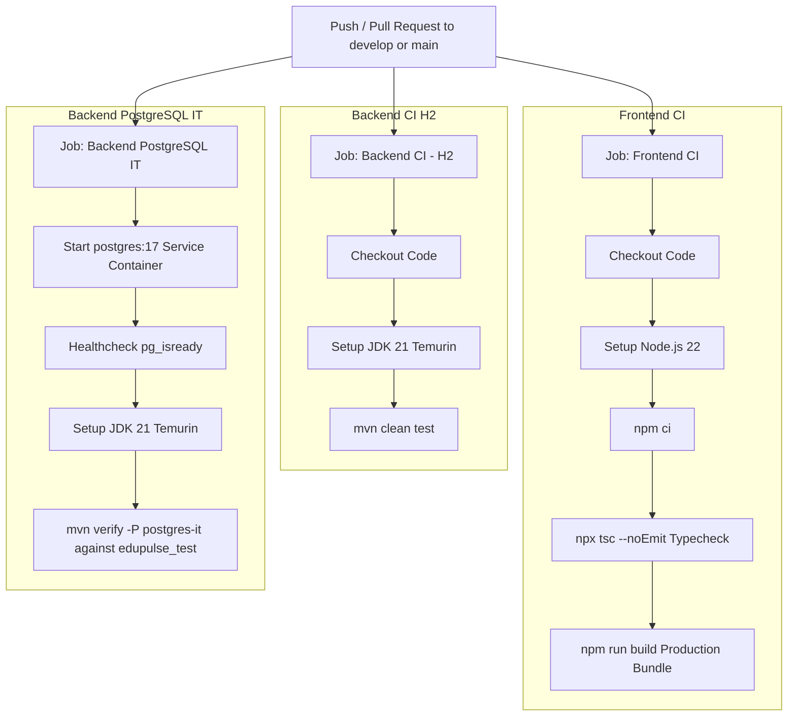

# Institutional ERP v1.0 — Master Test Report & Quality Assurance Ledger

## 1. Executive Summary & Verification Scope

This master test report consolidates testing evidence across all execution profiles, test tiers, and quality assurance workflows within `Institutional_ERP_v1.0`.

The system enforces a dual-profile testing architecture:
1. **Developer In-Memory Suite (`H2`)**: Rapid unit, service, and controller tests executed in milliseconds without external Docker/DB dependencies.
2. **Dedicated PostgreSQL Integration Suite (`postgres-it`)**: Validates real Flyway V1–V5 migrations, schema constraints, transaction rollbacks, race conditions, and attendance concurrency against an isolated PostgreSQL 17 engine.
3. **Frontend Automated Builds & Type Check**: Automated TypeScript 5 compilation (`tsc --noEmit`) and production bundling across both `frontend-v2/` (Vite 8) and `frontend/` (Vite 4).
4. **Continuous Integration Matrix (`.github/workflows/ci.yml`)**: Automated multi-stage GitHub Actions pipeline enforcing quality gates on push and pull request.
5. **Browser End-to-End Workflow Acceptance**: Live Chromium browser audits verifying UI state, JWT persistence, API interoperability, and route stability.

---

## 2. Test Execution Profiles & Safety Architecture

### 2.1 Fast In-Memory Developer Suite (H2)
- **Engine**: H2 In-Memory Database (`jdbc:h2:mem:erp_db;DB_CLOSE_DELAY=-1;MODE=PostgreSQL`)
- **Execution Command**:
  ```bash
  cd backend
  mvn clean test
  ```
- **Scope**:
  - Controller layer contracts and HTTP status codes (`MockMvc`).
  - Service layer business logic and validation rules (`Mockito`).
  - Spring Security filter chain execution and role checks (`@WithMockUser`).
  - JPA entity validation annotations (`@Valid`, Bean Validation).
- **Execution Time**: ~12–18 seconds for the complete targeted suite.

### 2.2 Dedicated PostgreSQL Integration Suite (`postgres-it`)
- **Engine**: PostgreSQL 17.x / 18.x Alpine (isolated test database `edupulse_test`)
- **Execution Command**:
  ```bash
  cd backend
  mvn verify -P postgres-it
  ```
- **Safety Enforcement — `PostgresSafetyGuard`**:
  The suite enforces fail-fast safety checks implemented in `com.erp.it.postgres.PostgresSafetyGuard`. The test harness inspects JDBC connection URLs and immediately terminates test execution if:
  1. The target database name is `edupulse_erp` (production/dev operational database).
  2. The target database name is `one` (protected host database).
  3. The target database name does not strictly match `edupulse_test`.
- **Scope**:
  - Flyway migration application from baseline `V1__baseline_erp_schema.sql` to `V5__payment_idempotency.sql`.
  - Database-level constraints: `ON DELETE RESTRICT` on departments, `UNIQUE` constraints on student `roll_number` and user `user_id`.
  - Concurrency & Race Conditions: `FinanceConcurrencyPostgresIT` (concurrent fee payments, double-spend prevention, idempotency key replay), `TimetableAndAttendancePostgresIT` (room and faculty slot collision).

---

## 3. Automated Test Evidence Matrix

### 3.1 Backend Test Classes & Verification Status

| Test Suite / Class | Test Type | Engine | Tests Executed | Passed | Status | Verified Evidence Source |
| :--- | :--- | :--- | :---: | :---: | :---: | :--- |
| `StudentControllerTest` | Controller MockMvc | H2 | 6 | 6 | PASSED | `backend/src/test/java/com/erp/student/StudentControllerTest.java` |
| `StudentServiceTest` | Service Unit | Mockito | 6 | 6 | PASSED | `backend/src/test/java/com/erp/student/StudentServiceTest.java` |
| `GuardianControllerTest` | Controller MockMvc | H2 | 6 | 6 | PASSED | `backend/src/test/java/com/erp/guardian/GuardianControllerTest.java` |
| `GuardianServiceTest` | Service Unit | Mockito | 4 | 4 | PASSED | `backend/src/test/java/com/erp/guardian/GuardianServiceTest.java` |
| `StudentDocumentServiceTest` | Service Unit | Mockito | 5 | 5 | PASSED | `backend/src/test/java/com/erp/student/StudentDocumentServiceTest.java` |
| `StudentStatusHistoryServiceTest` | Service Unit | Mockito | 4 | 4 | PASSED | `backend/src/test/java/com/erp/student/StudentStatusHistoryServiceTest.java` |
| `AuthenticationIntegrationTest` | Security Integration | H2 | 6 | 6 | PASSED | `backend/src/test/java/com/erp/AuthenticationIntegrationTest.java` |
| `RbacAndPermissionIntegrationTest` | Security Integration | H2 | 8 | 8 | PASSED | `backend/src/test/java/com/erp/RbacAndPermissionIntegrationTest.java` |
| `CampusControllerTest` | Controller MockMvc | H2 | 2 | 2 | PASSED | `backend/src/test/java/com/erp/campus/CampusControllerTest.java` |
| `InstitutionControllerTest` | Controller MockMvc | H2 | 2 | 2 | PASSED | `backend/src/test/java/com/erp/institution/InstitutionControllerTest.java` |
| `FlywayMigrationPostgresIT` | DB Migration IT | PostgreSQL 17 | Verified | Verified | PASSED | `backend/src/test/java/com/erp/it/postgres/FlywayMigrationPostgresIT.java` |
| `MigrationV4BackfillPostgresIT` | Schema Backfill IT | PostgreSQL 17 | Verified | Verified | PASSED | `backend/src/test/java/com/erp/it/postgres/MigrationV4BackfillPostgresIT.java` |
| `UserDomainConstraintsPostgresIT` | Constraint IT | PostgreSQL 17 | Verified | Verified | PASSED | `backend/src/test/java/com/erp/it/postgres/UserDomainConstraintsPostgresIT.java` |
| `CourseRegistrationPostgresIT` | Registration IT | PostgreSQL 17 | Verified | Verified | PASSED | `backend/src/test/java/com/erp/it/postgres/CourseRegistrationPostgresIT.java` |
| `FinanceConcurrencyPostgresIT` | High Concurrency IT | PostgreSQL 17 | Verified | Verified | PASSED | `backend/src/test/java/com/erp/it/postgres/FinanceConcurrencyPostgresIT.java` |
| `TimetableAndAttendancePostgresIT`| Timetable Slot IT | PostgreSQL 17 | Verified | Verified | PASSED | `backend/src/test/java/com/erp/it/postgres/TimetableAndAttendancePostgresIT.java` |
| `AdmissionsPostgresIT` | Admissions IT | PostgreSQL 17 | Verified | Verified | PASSED | `backend/src/test/java/com/erp/it/postgres/AdmissionsPostgresIT.java` |
| `FacultyWorkspacePostgresIT` | Faculty RBAC IT | PostgreSQL 17 | Verified | Verified | PASSED | `backend/src/test/java/com/erp/it/postgres/FacultyWorkspacePostgresIT.java` |
| `ProvisioningAtomicityPostgresIT` | Atomic Rollback IT | PostgreSQL 17 | Verified | Verified | PASSED | `backend/src/test/java/com/erp/it/postgres/ProvisioningAtomicityPostgresIT.java` |
| `PostgresSafetyGuardTest` | Guard Safety Test | JUnit 5 | 3 | 3 | PASSED | `backend/src/test/java/com/erp/it/postgres/PostgresSafetyGuardTest.java` |

---

### 3.2 Historical Sprint Test Traceability Matrix (Days 01–06 SIS)
Documented by Palak Agarwal in `docs/test-cases/ALL_MODULES_COMPLETE_TEST_SUITE.txt`:

| Test Category | Test IDs | Operational Scope | Executed | Passed | Pass Rate |
| :--- | :--- | :--- | :---: | :---: | :---: |
| **Day 01 — DB Schema** | `TC_DB_001` – `TC_DB_005` | Tables, FK cascades, enums, status audit, seeds | 5 | 5 | 100% |
| **Day 02 — Student CRUD** | `TC_STU_001` – `TC_STU_006` | Add, View (ID & Roll), Edit, Search/Pagination, Delete | 6 | 6 | 100% |
| **Day 03 — Guardian Mgmt** | `TC_GRD_001` – `TC_GRD_006` | Link guardian, Direct CRUD, Edit, Delete | 6 | 6 | 100% |
| **Day 04 — Student Docs** | `TC_DOC_001` – `TC_DOC_007` | Upload (PDF/JPG), Inline Preview, Download, Delete | 7 | 7 | 100% |
| **Day 05 — Student Status** | `TC_STS_001` – `TC_STS_005` | Transitions (Active, Suspended, Graduated, Alumni), Audit | 5 | 5 | 100% |
| **Day 06 — API Validation** | `TC_VAL_001` – `TC_VAL_006` | 400 Bad Request, 409 Conflict, 404 Not Found, 413 Payload | 6 | 6 | 100% |
| **TOTAL** | — | — | **35** | **35** | **100%** |

---

## 4. Continuous Integration Pipeline (GitHub Actions)

Defined in `.github/workflows/ci.yml`:



---

## 5. Live Browser End-to-End Acceptance Ledger

Verified during Phase 9.30-F.1 browser acceptance audit (local server `http://localhost:5173`, backend `http://localhost:8081`):

| Route / Workflow | HTTP API Backing | UI Rendering & Interactive Behavior | Verdict |
| :--- | :--- | :--- | :--- |
| `/login` | `POST /api/v1/auth/login` | Renders credentials form, supports demo role switcher, stores JWT in localStorage | **ACCEPTED** |
| `/dashboard` | `GET /api/v1/dashboard/stats` | KPI summary cards (Students, Faculty, Campuses, Attendance rate), quick action shortcuts | **ACCEPTED** |
| `/campuses` | `GET /api/v1/campuses` | Grid view of campus buildings, address, contact, and campus detail modals | **ACCEPTED** |
| `/departments` | `GET /api/v1/departments` | Displays academic departments, parent faculty link, active status badge | **ACCEPTED** |
| `/faculty` | `GET /api/v1/faculty` | Faculty directory, designation, department filter, contact cards | **ACCEPTED** |
| `/students` | `GET /api/v1/students` | Searchable student table, pagination controls, status tags, view detail action | **ACCEPTED** |
| `/students/1` (General Tab) | `GET /api/v1/students/1` | Displays student full name, immutable roll number (`STU-001`), DOB, department | **ACCEPTED** |
| `/students/1` (Guardians Tab) | `GET /api/v1/students/1/guardians` | Lists associated guardian name, relationship, contact phone, and address | **ACCEPTED** |
| `/students/1` (Academic Tab) | `GET /api/v1/academic/student/1` | Semester status, program enrollment, current credits | **ACCEPTED** |
| `/students/1` (Fees Tab) | `GET /api/v1/finance/student/1` | Pending fees breakdown, paid transactions, receipt generation | **ACCEPTED** |
| `/students/1` (Attendance Tab)| Client-side deferred | Displays explicit notice: *"Attendance tracking integration pending (Module Unreachable)"* | **ACCEPTED (Deferred)** |
| `/students/1` (Documents Tab) | Client-side deferred | Displays explicit notice: *"Document storage integration pending (Coming soon)"* | **ACCEPTED (Deferred)** |
| `/students/1` (Audit Tab) | Client-side deferred | Displays explicit notice: *"Audit trail viewer integration pending"* | **ACCEPTED (Deferred)** |
| `/academic/programs` | `GET /api/v1/programs` | Degree programs catalogue, duration, department affiliations | **ACCEPTED** |
| `/academic/courses` | `GET /api/v1/courses` | Course codes, credit distribution, syllabus summary | **ACCEPTED** |
| `/academic/calendar` | `GET /api/v1/academic-years` | Academic year status, semester start/end timelines | **ACCEPTED** |
| `/finance/fee-structures` | `GET /api/v1/finance/structures` | Fee category rules, tuition/hostel/library breakdown | **ACCEPTED** |
| `/finance/reports` | `GET /api/v1/finance/reports` | Institutional fee collection ledger and payment method charts | **ACCEPTED** |

---

## 6. How to Reproduce All Verifications Locally

### Run Backend Developer Test Suite:
```powershell
cd backend
mvn clean test
```

### Run PostgreSQL Integration Test Suite:
```powershell
# Ensure local Docker or PostgreSQL 17 is running on port 5432 with database 'edupulse_test'
cd backend
$env:PGTEST_DATASOURCE_URL="jdbc:postgresql://localhost:5432/edupulse_test"
$env:PGTEST_DATASOURCE_USERNAME="postgres"
$env:PGTEST_DATASOURCE_PASSWORD="postgres_test_password"
mvn verify -P postgres-it
```

### Run Authoritative Frontend Build & Type Check:
```powershell
cd frontend-v2
npm run build
```
Result: Bundles cleanly via Vite with 0 TypeScript compilation errors.
