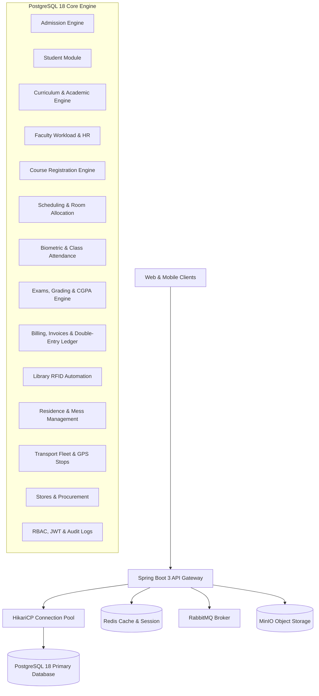
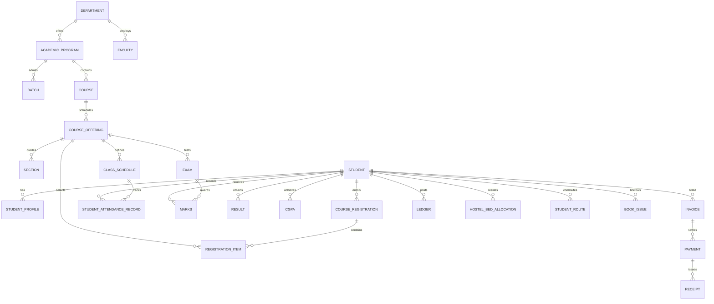

# EduPulse ERP - Enterprise University Database Architecture

EduPulse ERP is a 3NF normalized, production-grade relational database engine designed for universities, engineering colleges, and multi-campus higher education institutions. Built natively for **PostgreSQL 18**, EduPulse supports millions of concurrent student, faculty, and administrative transactions with sub-millisecond query latency.

---

## 🏛️ System Architecture



---

## 🗂️ Folder Structure

```text
edupulse/
├── docker-compose.yml              # PostgreSQL 18, Redis, RabbitMQ, MinIO services
├── application.properties          # Spring Boot datasource, HikariCP, JPA & Redis config
├── application.yml                 # Spring Boot YAML production profile
├── README.md                       # Comprehensive architecture and operations documentation
├── V1_create_core_database.sql     # Admission System & Academic Calendar (3NF)
├── V2_student_module.sql           # Complete Student Profiles, Guardians, Medicals
├── V3_academic_module.sql          # Departments, Degrees, Courses, Offerings, Sections
├── V4_faculty_module.sql           # Faculty, Designations, Workload & Payroll
├── V5_registration_module.sql      # Holds, Approvals, Course Drop & Withdrawal
├── V6_timetable_module.sql         # Buildings, Rooms, Slots & Timetable Schedules
├── V7_attendance_module.sql        # Biometric Logs, Student & Faculty Attendance
├── V8_exam_module.sql              # Examination Schedules, Hall Seating, Grades & CGPA
├── V9_finance_module.sql           # Fee Structures, Invoices, Razorpay Payments & Ledgers
├── V10_library_module.sql          # Books, Authors, Dewey Classes, Barcodes & Loans
├── V11_hostel_module.sql           # Hostels, Rooms, Beds, Allocations & Mess Subscriptions
├── V12_transport_module.sql        # Transport Vehicles, Drivers, Routes & Geofenced Stops
├── V13_hr_module.sql               # Employees, Recruitments, Appraisals & Monthly Payroll
├── V14_inventory_module.sql        # Central Stores, Vendors, POs, Items & Stock Issuance
├── V15_notification_module.sql     # Email, SMS, Push & Queue Dispatch Logs
├── V16_document_module.sql         # Folders, Storage Keys, File Versioning & Vault Archives
├── V17_analytics_module.sql        # KPI Metrics, Dashboards, Materialized Views
├── V18_security_module.sql         # App Users, RBAC, JWT Key Store, Sessions & Audits
├── V19_indexes.sql                 # High-performance B-Tree, Composite & GIN JSONB Indexes
├── V20_seed_data.sql               # 500+ Realistic University Seed Records
├── V21_testing.sql                 # Automated Integrity, Constraints & Transaction Tests
├── V22_views.sql                   # Student, Faculty, Admin, Finance & Exam Dashboards
├── V23_functions.sql               # PL/pgSQL Stored Procedures & Calculation Algorithms
├── V24_triggers.sql                # updated_at, Audits, Ledgers, Summaries & Cascades
├── V25_backup_restore.sql          # DBA Roles, Permissions, Automated Maintenance Plans
└── V26_cleanup.sql                 # Sequence Identity Resets & Health Checks
```

---

## 📊 Entity Relationship Diagram (ERD)



---

## 🚀 How to Run with Docker Compose

1. **Start the Infrastructure Stack**:
   ```bash
   docker compose up -d
   ```
2. **Verify Services**:
   - PostgreSQL 18: `localhost:5432`
   - Redis: `localhost:6379`
   - RabbitMQ Management Console: `http://localhost:15672` (User: `edupulse_mq`, Pass: `edupulse_mq_secret_2026`)
   - MinIO Object Storage Console: `http://localhost:9001` (User: `edupulse_minio_admin`, Pass: `edupulse_minio_secret_2026`)

---

## 🛠️ Executing SQL Migration Files

**CRITICAL**: Do NOT execute files alphabetically (e.g., using `ls | sort`). This will execute `V10` through `V19` before `V2`, causing "relation does not exist" errors.

To run all migrations strictly in the correct chronological sequence, use the provided execution scripts:

**Windows**:
```cmd
execute_all.bat
```

**Linux/macOS**:
```bash
chmod +x execute_all.sh
./execute_all.sh
```

Alternatively, to run manually using `psql`:

```bash
export PGPASSWORD="edupulse_secure_password_2026"

psql -h localhost -p 5432 -U edupulse_admin -d edupulse_erp -f V1_create_core_database.sql
psql -h localhost -p 5432 -U edupulse_admin -d edupulse_erp -f V2_student_module.sql
psql -h localhost -p 5432 -U edupulse_admin -d edupulse_erp -f V3_academic_module.sql
psql -h localhost -p 5432 -U edupulse_admin -d edupulse_erp -f V4_faculty_module.sql
psql -h localhost -p 5432 -U edupulse_admin -d edupulse_erp -f V5_registration_module.sql
psql -h localhost -p 5432 -U edupulse_admin -d edupulse_erp -f V6_timetable_module.sql
psql -h localhost -p 5432 -U edupulse_admin -d edupulse_erp -f V7_attendance_module.sql
psql -h localhost -p 5432 -U edupulse_admin -d edupulse_erp -f V8_exam_module.sql
psql -h localhost -p 5432 -U edupulse_admin -d edupulse_erp -f V9_finance_module.sql
psql -h localhost -p 5432 -U edupulse_admin -d edupulse_erp -f V10_library_module.sql
psql -h localhost -p 5432 -U edupulse_admin -d edupulse_erp -f V11_hostel_module.sql
psql -h localhost -p 5432 -U edupulse_admin -d edupulse_erp -f V12_transport_module.sql
psql -h localhost -p 5432 -U edupulse_admin -d edupulse_erp -f V13_hr_module.sql
psql -h localhost -p 5432 -U edupulse_admin -d edupulse_erp -f V14_inventory_module.sql
psql -h localhost -p 5432 -U edupulse_admin -d edupulse_erp -f V15_notification_module.sql
psql -h localhost -p 5432 -U edupulse_admin -d edupulse_erp -f V16_document_module.sql
psql -h localhost -p 5432 -U edupulse_admin -d edupulse_erp -f V17_analytics_module.sql
psql -h localhost -p 5432 -U edupulse_admin -d edupulse_erp -f V18_security_module.sql
psql -h localhost -p 5432 -U edupulse_admin -d edupulse_erp -f V19_indexes.sql
psql -h localhost -p 5432 -U edupulse_admin -d edupulse_erp -f V20_seed_data.sql
psql -h localhost -p 5432 -U edupulse_admin -d edupulse_erp -f V21_testing.sql
psql -h localhost -p 5432 -U edupulse_admin -d edupulse_erp -f V22_views.sql
psql -h localhost -p 5432 -U edupulse_admin -d edupulse_erp -f V23_functions.sql
psql -h localhost -p 5432 -U edupulse_admin -d edupulse_erp -f V24_triggers.sql
psql -h localhost -p 5432 -U edupulse_admin -d edupulse_erp -f V25_backup_restore.sql
psql -h localhost -p 5432 -U edupulse_admin -d edupulse_erp -f V26_cleanup.sql
```

---

## 💾 Backup and Restoration

### Automated Backup (Custom Compressed Format)
```bash
pg_dump -h localhost -p 5432 -U edupulse_backup_operator -d edupulse_erp -F c -b -v -f /backups/edupulse_erp_full_$(date +%Y%m%d).dump
```

### Point-In-Time Restoration
```bash
pg_restore -h localhost -p 5432 -U edupulse_admin -d edupulse_erp -v --clean --if-exists /backups/edupulse_erp_full_20260315.dump
```

---

## 🖥️ Connecting via pgAdmin 4

1. Open pgAdmin 4.
2. Right-click on **Servers** -> **Register** -> **Server...**.
3. **General Tab**:
   - Name: `EduPulse Local Production`
4. **Connection Tab**:
   - Host name/address: `localhost`
   - Port: `5432`
   - Maintenance database: `edupulse_erp`
   - Username: `edupulse_admin`
   - Password: `edupulse_secure_password_2026`
   - Save Password: `Checked`
5. Click **Save**.

---

## ☕ Spring Boot 3 Integration & JDBC Connection

EduPulse ERP is pre-configured with `application.properties` and `application.yml`.

### JDBC Connection String
```properties
spring.datasource.url=jdbc:postgresql://localhost:5432/edupulse_erp?sslmode=disable&ApplicationName=EduPulse_Backend
spring.datasource.username=edupulse_admin
spring.datasource.password=edupulse_secure_password_2026
spring.datasource.driver-class-name=org.postgresql.Driver
```

### HikariCP High-Concurrency Pool
- Max Pool Size: 30
- Min Idle: 10
- Connection Timeout: 20000ms
- Idle Timeout: 300000ms

---

## 📸 Database Screenshots Placeholders

| Section | Preview |
|---|---|
| **Executive Governance Dashboard** | `[Placeholder: Executive KPI and enrollment overview]` |
| **Course Registration & Degree Audit** | `[Placeholder: Real-time credit limits and hold verifications]` |
| **Financial Ledger Reconciliation** | `[Placeholder: Double-entry debit/credit ledger tracking]` |
| **Examination Grading & Transcripts** | `[Placeholder: SGPA and CGPA computation report]` |

---

## 🛡️ License
Proprietary & Confidential - University Educational ERP Architecture.
